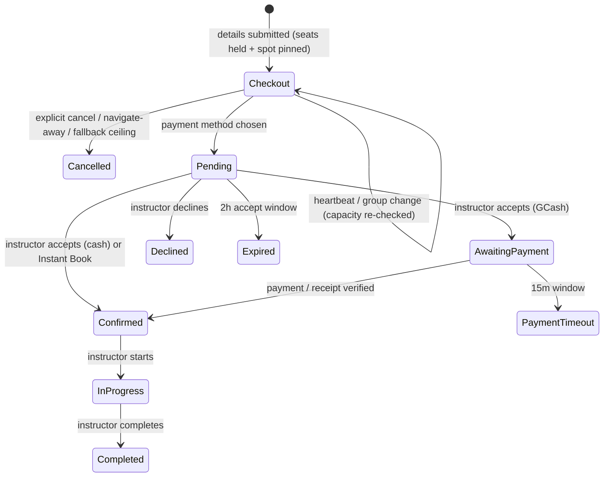

# Booking Checkout Hold and Seat Capacity - Decision Record

> **Status:** approved decisions for implementation.
> **Scope:** the phase between "student submits lesson details" and "student chooses a payment method", plus the seat-capacity rules that phase depends on.
> **Related:** `BOOKING_FLOWS.md` (current flow), `SPOT_BASED_BOOKING_PROPOSAL.md` (spot pin / tide flow).

---

## 1. Decisions

| # | Question | Decision |
|---|---|---|
| 1 | Hold duration | **Scale by group size**: `min(30, 15 + 5 x (participants - 1))` minutes. Configurable. |
| 2 | Release during waiver | **No automatic timeout while the student is actively signing.** Release only when the student explicitly cancels / chooses not to proceed. |
| 3 | Instructor notification | **Do not notify the instructor** during checkout. Notify only when the payment method is chosen. |
| 4 | Visibility to other students | **Reduced seat count only.** No "reserved by another student" label. |
| 5 | Group booking | Yes. A student can book for a group: L2 up to 2, L3 up to 2-5. L1 is 1-on-1. Participants and their details are collected as today. |
| 6 | Group waiver signing | **Every participant signs.** Minors also require guardian/parental consent, exactly as today. |
| 7 | Group changes during checkout | **Re-check capacity and adjust the held seats.** |
| 8 | Abandonment | Also release when the student navigates away or closes the tab (best effort), in addition to explicit cancel. |
| 9 | Spot pin timing | **Pin the spot at details submission** (recommended option). |

### 1.1 Capacity (corrected)

| Level | Seats | Group size | Behaviour |
|---|---|---|---|
| Level 1 | **1** | 1 only (1-on-1) | A live checkout/booking fills the slot. No separate "exclusive" flag is needed. |
| Level 2 | **2** | 1 or 2 | Seats-only; one 2-student booking or two separate 1-student bookings at the same spot/time. |
| Level 3 | **5** | 1 to 5 | Seats-only; one group booking or several bookings at the same spot/time until 5 seats are used. |

Capacity is **per instructor**, never per surf spot. A spot has no seat cap and no instructor cap.

> **Implementation note:** the code currently encodes L1 = 2 / L2 = 1 / L3 = 5. This decision supersedes that table; the code, safety rules, config defaults, UI labels and tests must be updated (section 8).

---

## 2. The problem this fixes

Without a dedicated checkout hold:

- Student A submits details, goes to the waiver page, and the booking holds the instructor's seats for the full 2-hour acceptance window.
- If A abandons, the seats stay blocked until the 2-hour deadline passes and the 5-minute sweep runs.
- Student B sees fewer seats (or none) and cannot book, even though A is not proceeding.
- Conversely, if the booking were only created after the waiver, B could take A's seats while A is signing.

The checkout hold makes the reservation explicit, immediate, and releasable without waiting 2 hours.

---

## 3. Hold scope: seats only

The hold reserves exactly the seats the student selected:

| Level | A's group | Held seats | Remaining for B |
|---|---|---|---|
| L1 | 1 | 1 of 1 | 0 - B cannot book |
| L2 | 1 | 1 of 2 | 1 - B can book the second seat at the same spot |
| L2 | 2 | 2 of 2 | 0 |
| L3 | 2 | 2 of 5 | 3 |
| L3 | 5 | 5 of 5 | 0 |

The **spot pin still applies**: all overlapping bookings for the same instructor/time must use the same `surf_spot_id`. If A is at Cloud 9, B can join only Cloud 9, never Jacking Horse.

---

## 4. Hold duration and release

### 4.1 Duration formula

```
minutes = min(30, 15 + 5 * (participants - 1))
```

| Participants | Hold ceiling |
|---|---|
| 1 | 15 min |
| 2 | 20 min |
| 3 | 25 min |
| 4 | 30 min |
| 5 | 30 min |

The value is configurable (`config/siasurf.php`), so SISA can tune it without a deploy.

### 4.2 What the ceiling means

The ceiling is a **fallback for a browser that disappears without sending a release signal** (crash, dead battery, network loss). It is **not** a countdown that expires while the student is actively signing.

- While the waiver page is open, a **heartbeat** (every 60 seconds) extends `checkout_hold_until`.
- Decision #2: the hold does **not** auto-release while the student is actively signing.
- The hold releases immediately when:
  - the student clicks **Cancel / Do not proceed**;
  - the student navigates away or closes the tab (`pagehide` + `sendBeacon`);
  - the student's browser never sends a signal and the scaled ceiling is reached (fallback);
  - the student completes the payment-method step (the hold converts into a formal request; the seats stay held through the acceptance/payment windows).
- A tab left open indefinitely keeps the hold. This is intentional per decision #2; see the open question in section 9 about a hard maximum.

### 4.3 Heartbeat vs ceiling

```
on details submit:
  checkout_hold_until = now + minutes(formula)

every 60s while the waiver page is visible:
  POST /bookings/{booking}/checkout/heartbeat
  checkout_hold_until = now + minutes(formula)

on cancel / navigate-away / tab close:
  POST /bookings/{booking}/checkout/release
  release seats + spot pin (if no other live booking)

fallback job (every minute):
  if status = checkout and checkout_hold_until < now
    release seats + spot pin
    status = cancelled (reason: checkout hold expired)
```

Page visibility matters: pause the heartbeat when the page is hidden? Decision #2 says release only on explicit cancel/navigate-away. A hidden tab is still "open". Recommendation: keep the heartbeat while the page is open, but treat `visibilitychange` to hidden as a warning, not a release. The fallback ceiling still protects against a disappeared browser.

---

## 5. End-to-end flow

### 5.1 Student

```
1. Details form
   date, start/end, party size, participants, spot, board rule
2. Submit
   -> booking created: status = checkout
   -> seats held immediately (student_count)
   -> spot pinned for the instructor/time
   -> checkout_hold_until set from the formula
   -> redirect to the waiver page
3. Waiver page
   -> "Your seats are reserved while you complete this step"
   -> each participant signs liability; minors also sign parental consent
   -> heartbeat keeps the hold alive
   -> the student may change the group size (capacity is re-checked)
   -> Cancel / Do not proceed releases the seats immediately
   -> closing/navigating away sends a release signal
4. Payment method
   -> status changes from checkout to pending
   -> checkout_hold_until cleared
   -> accept_deadline_at = now + 2h (clamped)
   -> instructor is notified for the first time
   -> the existing acceptance/payment flow continues
```

### 5.2 System

```
- Hold seats at details submit, not after the waiver.
- Keep the hold alive while the waiver page is open.
- Release on explicit cancel, navigate-away, or the fallback ceiling.
- Never notify the instructor during checkout.
- Convert to pending only when the payment method is chosen.
- Pin the spot at details; release/re-anchor the pin when the last overlapping
  checkout/booking goes away.
- Re-check skill, spot difficulty, capacity and tide whenever the group changes.
```

### 5.3 Instructor

```
- Nothing appears in the instructor queue during checkout.
- At payment method selection, the request appears with:
  the group size, the pinned spot, the exact time and the accept countdown.
- The instructor accepts/declines as today.
```

### 5.4 State machine



`checkout` is a new status. It is **not** visible to the instructor and does **not** start the 2-hour acceptance job.

---

## 6. Group booking rules

### 6.1 Size and capacity

| Level | Max group | Held seats |
|---|---|---|
| L1 | 1 | 1 |
| L2 | 2 | 1-2 |
| L3 | 5 | 1-5 |

- The student enters `student_count` and the participant details on the details form.
- The hold reserves `student_count` seats.
- L1 is 1-on-1; the group option is disabled for L1.
- L2 and L3 can be a single group booking or several separate bookings at the same spot/time, as long as the total seats do not exceed capacity.
- The spot pin applies across all bookings for the same instructor/time.

### 6.2 Participant details and waivers

- Primary participant = the account holder (profile skill level is authoritative).
- Companions: name, age, height/weight (unless own board), skill level, emergency contact, medical info, guardian info for minors.
- Every participant signs their own liability waiver.
- A participant under 18 also requires parental consent (guardian details, emergency contact, medical info).
- The group uses `SkillLevel::mostRestrictive()` for the spot difficulty and instructor visibility.

### 6.3 Group changes during checkout

The student may change the group on the waiver/checkout page. When that happens:

1. Recalculate `student_count` and the price.
2. Re-check `remaining_capacity` for the pinned instructor/spot/time.
   - If the new size fits, update the booking and adjust the held seats.
   - If it does not fit, reject the change and keep the previous group; show the remaining seats.
3. Re-check the most restrictive skill against the pinned spot's difficulty.
   - Adding a beginner to an intermediate/advanced spot blocks the change.
   - The student must remove that participant or request a different spot/time.
4. Re-run the safety rules (age 5-12, group ceiling, certification).
5. Extend the checkout hold using the new group size formula.

### 6.4 What the group sees during checkout

- "Your seats are reserved" (no countdown pressure; the hold is heartbeat-driven).
- A clear "Cancel and release seats" action.
- The pinned spot and allowed student levels.
- The price for the current group size.

---

## 7. Data model and endpoints

### 7.1 Booking status

Add `checkout` to `App\Enums\BookingStatus`:

| Status | Meaning | Holds seats? | Visible to instructor? |
|---|---|---|---|
| `checkout` | Student is signing waivers / choosing payment; seats are held | **Yes** | **No** |
| `pending` | Formal request waiting for the instructor | Yes | Yes |
| ... | existing states | ... | ... |

- `slotHolding()` must include `checkout`.
- `changeable()` may include `checkout` for the student's own edit/cancel actions, or use dedicated checkout endpoints.
- `canBeCancelled()` must allow a checkout booking to be released.

### 7.2 Booking columns

| Column | Type | Purpose |
|---|---|---|
| `checkout_hold_until` | timestamp nullable | Fallback ceiling |
| `checkout_heartbeat_at` | timestamp nullable | Last heartbeat |
| `checkout_released_at` | timestamp nullable | When the hold was released |
| `checkout_release_reason` | string nullable | `cancelled`, `navigated_away`, `expired`, `converted` |
| `spot_pin_id` | FK nullable | The pin that governs the booking |
| `spot_confirmed_at` / `spot_confirmed_by` | timestamp / FK | Instructor confirmation |
| `tide_snapshot` | json nullable | Conditions at booking time |

`student_count` and `booking_participants` already exist.

### 7.3 Endpoints

| Method | URI | Purpose |
|---|---|---|
| POST | `/bookings/{booking}/checkout/heartbeat` | Extend `checkout_hold_until`; only the owning student; only while `checkout` |
| POST | `/bookings/{booking}/checkout/release` | Release seats + pin; reason `cancelled` or `navigated_away` |
| PATCH | `/bookings/{booking}/checkout/group` | Update participants/student_count, re-check capacity, recalculate price |
| POST | `/bookings/{booking}/payment` | Existing step: converts `checkout` -> `pending`, starts the acceptance window |
| GET | `/bookings/{booking}/waiver` | Existing waiver page; now shows the reservation state |
| GET | `/bookings/{booking}/parental-consent` | Existing consent page |

### 7.4 Client release signal

On `pagehide` (covers tab close, navigation and most mobile backgrounding):

```js
navigator.sendBeacon(
  route('bookings.checkout.release', booking.id),
  new Blob([JSON.stringify({ reason: 'navigated_away' })], { type: 'application/json' })
);
```

- Add a client flag when the student clicks "Back / Edit details" so that action does **not** release the hold; it extends it instead.
- If `sendBeacon` is unavailable, use `fetch(..., { keepalive: true })`.
- If the signal never arrives, the fallback job releases at `checkout_hold_until`.

### 7.5 Fallback job

`bookings:expire-checkout-holds` every minute:

```
find status = checkout
  and checkout_hold_until < now
-> release seats
-> release/re-anchor the spot pin
-> status = cancelled
-> checkout_release_reason = expired
```

No instructor notification for this release.

### 7.6 Conversion to a formal request

`storePayment` currently sets `accept_deadline_at` and dispatches `ExpireBookingAcceptanceJob`. Change it to:

```
if booking.status == checkout:
    booking.status = pending
    booking.checkout_hold_until = null
    booking.checkout_release_reason = converted
    booking.accept_deadline_at = acceptDeadlineFrom()
    create/update payment record
    dispatch ExpireBookingAcceptanceJob
    broadcast BookingCreated
    notify instructor
```

If the checkout hold already expired before the student chose a payment method, do not convert; show "your reservation expired" and send them back to rebook.

---

## 8. Code changes required

### 8.1 Capacity table (L1 = 1, L2 = 2, L3 = 5)

| File | Change |
|---|---|
| `app/Enums/InstructorLevel.php` | `maxStudents()` 1/2/5; `description()` text; `allowsParallelBookings()` true for L2; simplify/remove `holdsSlotWhilePending()` because capacity 1 already makes L1 exclusive. |
| `app/Services/SafetyService.php` | `validateLevel1Rules` max 1; `validateLevel2Rules` max 2; `validateParticipants` map; `getApplicableRules` max students. |
| `config/siasurf.php` | `instructor_capacity` defaults 1/2/5. |
| `resources/js/Pages/Booking/Create.vue` | `maxStudents` computed 1/2/5; group option disabled for L1; helper text. |
| `resources/js/Pages/Instructor/Dashboard.vue` | Level 2 label "up to 2 students". |
| `database/factories/BookingFactory.php` | Random student counts respect 1/2/5. |
| Tests | `SafetyServiceTest`, `SkillLevelMatchingTest`, `SlotCapacityTest`, `BookingControllerTest`, `BookingFlowTest`, `InstructorDirectoryTest`. |
| Project docs | `AGENTS.md`, `prd.md`, `masterplandevelopment.md`, `siargao-surfinfo`, `IMPLEMENTATION_CORRECTIONS.md`. |

### 8.2 Checkout hold

| File | Change |
|---|---|
| `app/Enums/BookingStatus.php` | Add `checkout`; include it in `slotHolding()`. |
| `app/Http/Controllers/BookingController.php` | `storeDetails` creates `checkout`, sets the hold, pins the spot, does **not** set `accept_deadline_at` or dispatch the acceptance job; `storePayment` converts to `pending`. |
| `app/Services/AvailabilityService.php` | Capacity/pin checks include `checkout`; release/re-anchor. |
| `app/Services/CheckoutHoldService.php` (new) | Duration formula, heartbeat, release, group-change re-check. |
| `app/Http/Controllers/CheckoutController.php` (new) | heartbeat/release/group endpoints and authorization. |
| `app/Jobs/ExpireCheckoutHoldJob.php` + command | Fallback expiry every minute. |
| `app/Models/Booking.php` | `isCheckout()`, hold fields, release helper. |
| `app/Observers/BookingObserver.php` | Do not provision chat for `checkout`; only from `confirmed` as today. |
| `resources/js/Pages/Booking/Waiver.vue` | "Seats reserved" state, heartbeat, release on pagehide, cancel action, group editor. |
| `resources/js/Pages/Booking/ParentalConsent.vue` | Same heartbeat/release handling. |
| `resources/js/Pages/Student/Bookings/*` | Show `checkout` as "In checkout" if the student returns to the list. |
| `resources/js/Pages/Instructor/Bookings/*` | Exclude `checkout` from the roster and notifications. |
| Tests | New `CheckoutHoldTest` (heartbeat, cancel, navigate-away, expiry, group change, capacity). |

### 8.3 Non-goals in this change

- No spot seat capacity.
- No instructor notification during checkout.
- No automatic timeout release while the waiver page is actively heartbeating.
- No change to the post-payment lifecycle.

---

## 9. Edge cases

| Situation | Expected behaviour |
|---|---|
| Student closes the tab | `pagehide` sends the release; seats free immediately. |
| Browser crashes / battery dies | No release signal; the fallback ceiling expires the hold. |
| Student clicks Back to edit details | Do not release; extend the hold and keep the seats. |
| Student clicks Cancel / Do not proceed | Release immediately; status cancelled; reason `cancelled`. |
| Group size increases beyond remaining seats | Reject the change, keep the previous group, show remaining seats. |
| Group size decreases | Release the extra seats, recalculate price, extend the hold. |
| New participant lowers the party skill below the pinned spot | Reject the change; the student must remove them or request another spot/time. |
| Hold expires while the student is still on the page | Only possible if heartbeats stopped (network loss). Show "reservation expired" and offer to rebook. |
| Payment method chosen after expiry | Do not convert; send to rebook. |
| Two students submit at the same instant | Instructor row lock + capacity/pin re-check; the loser gets a clear error. |
| Instructor has a manual spot assignment | The student can only book that spot for the instructor/time. |
| Instructor declines the pending request | Seats release; pin re-anchors or releases. |
| SISA closes the spot | Cancel the checkout/booking for safety; release seats; notify. |
| L1 group request | Blocked; Level 1 is 1-on-1. |
| L2 group of 3 | Blocked (max 2). |
| L3 group of 6 | Blocked (max 5). |

---

## 10. Open questions

1. **Hard maximum for a tab left open:** decision #2 says no automatic release while the student is signing. Do you want a safety maximum (e.g., 2 hours, the acceptance window) for an idle tab that never closes? Without one, a tab left open can hold seats indefinitely.
2. **Multiple checkout holds:** should a student be limited to one active checkout at a time? The current guard allows up to 3 open requests. Recommended: one checkout, counted toward the 3-request cap.
3. **Countdown UI:** should the waiver page show a timer, or only "seats reserved" (since the hold does not auto-release while active)? Recommended: "seats reserved" plus a cancel action, with no countdown pressure.
4. **Group editor access:** should the group be editable on the waiver page, or only by going back to the details form? Decision #7 says capacity is re-checked; the simplest UX is an "Edit group" action on the waiver page.
5. **Back-to-edit semantics:** confirm that clicking Back to the details form should keep the hold and extend it, not release it.
6. **Checkout visibility on the student list:** should a checkout booking appear as "In checkout" so the student can resume, or remain hidden until payment method? Recommended: show it with a "Resume checkout" action.

---

## 11. Relationship to the other documents

- `BOOKING_FLOWS.md` describes the current implementation. Its capacity table has been updated to L1 = 1 / L2 = 2 / L3 = 5 and it points here for the target checkout behaviour.
- `SPOT_BASED_BOOKING_PROPOSAL.md` defines the spot pin and tide-first discovery. The checkout hold uses the same pin: the spot is pinned at details submission and released/re-anchored with the seats.
- This document is the implementation contract for the checkout phase until the code is updated.

---

## 12. Sources / references

- Current booking creation: `BookingController::storeDetails`
- Current capacity and slot locks: `AvailabilityService`
- Current safety ceilings: `SafetyService`
- Current statuses: `BookingStatus`
- Current waiver flow: `WaiverController`
- Current acceptance/payment: `BookingAcceptanceService`, `PaymentController`
- Capacity and group rules: `InstructorLevel`, `SkillLevel`

---

## 13. Summary of the approved flow

> The student submits details, which immediately creates a **checkout** reservation: the selected seats are held, the spot is pinned, and a group-size-scaled fallback ceiling is stored. While the student signs the waivers, a heartbeat keeps the reservation alive; the seats are released only if the student cancels, navigates away or closes the tab, or the browser disappears and the fallback ceiling expires. The instructor is not notified and cannot see the reservation during checkout. When the student chooses a payment method, the reservation becomes a normal pending request, the 2-hour acceptance window starts, and the instructor is notified. Group size is 1 for Level 1, up to 2 for Level 2, and up to 5 for Level 3; every participant signs, and minors require guardian consent.

