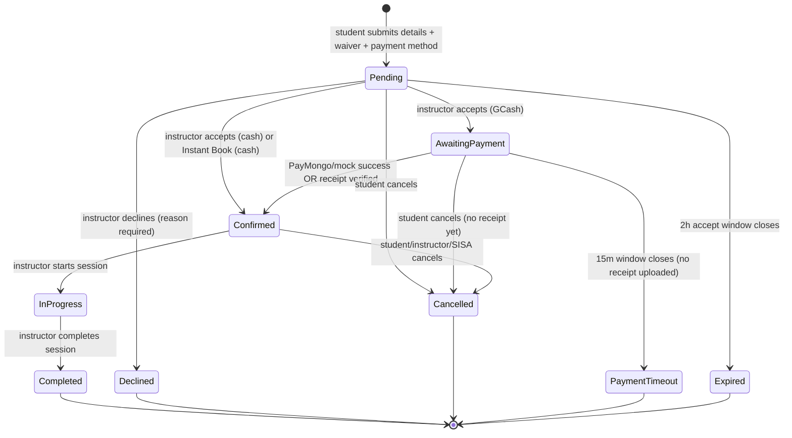
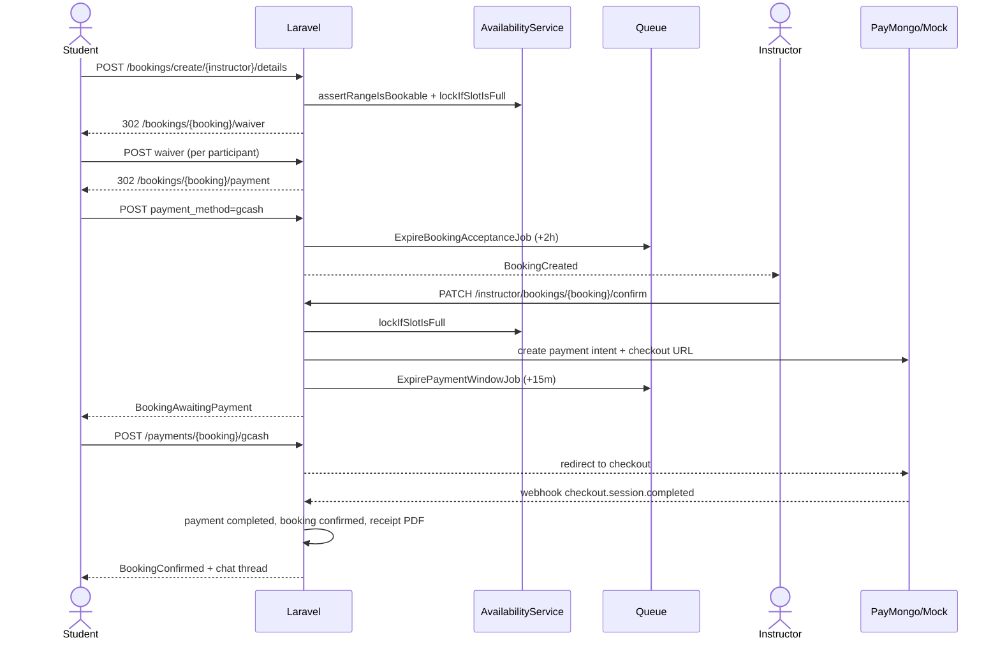
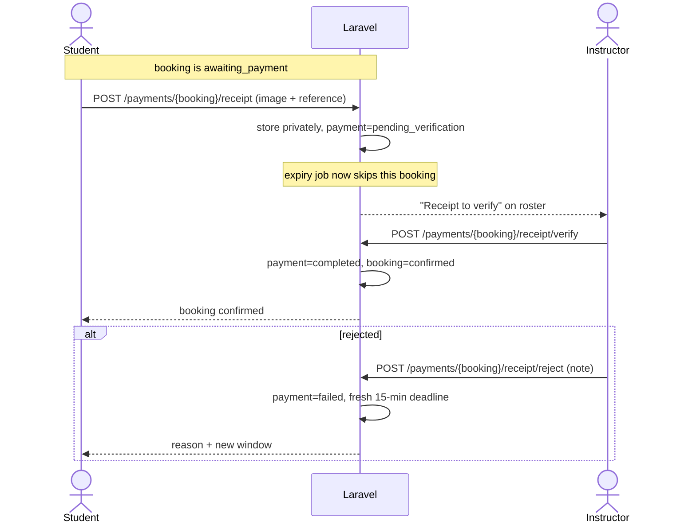
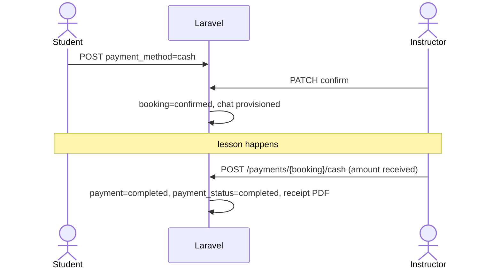
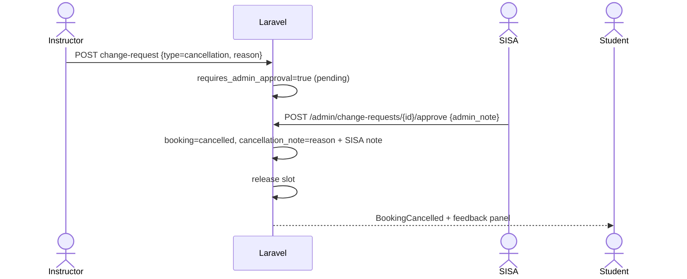

# SiaSurf - Current Booking Flows (Student <-> Instructor)

> **Scope:** the booking lifecycle as implemented in this repository today: discovery, request creation, waivers, acceptance, GCash/cash payment, receipt verification, session execution, cancellation/reschedule, feedback, suspension and the SISA touchpoints that can change a booking.
>
> **Source of truth:** the code paths listed in section 14. If behaviour changes, update this file in the same pull request.

---

## Table of contents

1. [Roles and preconditions](#1-roles-and-preconditions)
2. [Booking statuses](#2-booking-statuses)
3. [Timers and business constants](#3-timers-and-business-constants)
4. [Matching and safety rules](#4-matching-and-safety-rules)
5. [Availability and slot capacity](#5-availability-and-slot-capacity)
6. [Master state machine](#6-master-state-machine)
7. [Student flows](#7-student-flows)
8. [Instructor flows](#8-instructor-flows)
9. [Admin touchpoints](#9-admin-touchpoints)
10. [Events and notifications](#10-events-and-notifications)
11. [Route map](#11-route-map)
12. [Sequence diagrams](#12-sequence-diagrams)
13. [Edge cases and failure paths](#13-edge-cases-and-failure-paths)
14. [Code map](#14-code-map)

---

## 1. Roles and preconditions

| Role | Must satisfy before booking actions |
|---|---|
| **Student** | `role = student`, email verified (`verified` middleware), has a `student_profiles` row (skill level, first-time flag). |
| **Instructor** | `role = instructor`, email verified, `instructor_profiles.status = active`, at least one verified and unexpired certificate, not suspended (`User::isBookable()`). |
| **Admin (SISA/LGU)** | `role = admin`, email verified. |

Registration (student or instructor) -> verification email -> `/verify-email` -> dashboard. Unverified users cannot reach booking, payment, chat or dashboard routes.

A suspended instructor is redirected to `/instructor/suspended` by `EnsureInstructorNotSuspended`; the suspension page and the appeal endpoint remain reachable.

---

## 2. Booking statuses

`App\Enums\BookingStatus` has **11 states**, stored in `bookings.status`.

| Status | Meaning | Holds the slot? | Can still change? | Final? |
|---|---|---|:---:|:---:|
| `pending` | Request sent, waiting for the instructor (or Instant Book) | YES | YES | NO |
| `awaiting_payment` | Instructor accepted a GCash booking; 15-minute hold running | YES | YES | NO |
| `confirmed` | Lesson locked in (cash accepted, GCash paid, or receipt verified) | YES | YES | NO |
| `in_progress` | Instructor started the live session | YES | NO | NO |
| `completed` | Session finished | NO | NO | YES |
| `declined` | Instructor turned the request down (reason stored) | NO | NO | YES |
| `cancelled` | Student, instructor or SISA cancelled | NO | NO | YES |
| `payment_timeout` | 15-minute payment window expired | NO | NO | YES |
| `expired` | Instructor never answered inside 2 hours | NO | NO | YES |
| `no_show` | Reserved state for a missed lesson | NO | NO | YES |

> `no_show` is defined but no current code path sets it. Absence is recorded in `attendance_status = absent` instead.

- `slotHolding()` = pending, awaiting_payment, confirmed, in_progress.
- `changeable()` = pending, awaiting_payment, confirmed.
- `decline_reason` stores why an instructor declined or why a request expired.
- `cancellation_reason` stores who/why (enum); `cancellation_note` stores the free-text explanation shown to the student.

---

## 3. Timers and business constants

Defined on `App\Models\Booking` unless noted.

| Constant | Value | Effect |
|---|---|---|
| `ACCEPT_WINDOW_HOURS` | **2 h** | Instructor must accept or decline a request. |
| `PAYMENT_HOLD_MINUTES` | **15 min** | Student must complete GCash payment after acceptance. |
| `CHANGE_APPROVAL_THRESHOLD_HOURS` | **24 h** | Instructor cancellation/reschedule inside this window needs SISA approval. |
| `PRE_LESSON_BUFFER_HOURS` | **1 h** | No request can be accepted or paid inside 1 h of the lesson; acceptance/payment deadlines are clamped to lesson start minus 1 h. |
| `START_TOLERANCE_HOURS` | **2 h** | "Start session" is allowed from 2 h before to 2 h after the scheduled start, on the lesson date only. |
| `MAX_OPEN_REQUESTS_PER_STUDENT` | **3** | A student cannot hold more than 3 pending/awaiting-payment requests. |
| `standardHours()` | **2 h** (`config/siasurf.php` -> `session.standard_hours`) | Default lesson length when the instructor has no slot duration. |
| Slot duration | **60 or 120 min** (`availabilities.slot_duration_minutes`) | Drives the default end time and price estimate. |
| Slot capacity | **L1 = 2, L2 = 1, L3 = 5** (`config/siasurf.php` -> `instructor_capacity`; env `SIASURF_LEVEL{1,2,3}_CAPACITY`) | Students who may share one time slot. |

> **Level 2 policy:** every project document defines Level 2 as 1-on-1, so its capacity defaults to **1**. If SISA changes that policy, set `SIASURF_LEVEL2_CAPACITY`; no code change is required. Each individual booking is still capped at 1 student by `SafetyService`.

---

## 4. Matching and safety rules

### 4.1 Student skill -> instructor level (directory visibility)

`SkillLevel::instructorLevels()`:

| Student level | Instructors visible |
|---|---|
| Beginner | Level 1, 2 **and** 3 |
| Intermediate | Level 2 **and** 3 (Level 1 is beginner-only) |
| Advanced | Level 3 only |

A student cannot widen their own results with `?skill_level=` or `?level=`; the requested level is intersected with the allowed list. Direct URLs to a profile or booking form the student may not use return **404**. `storeDetails` re-checks the same rule server-side.

### 4.2 Student skill -> surf-spot difficulty

`SkillLevel::allowedSurfSpotDifficulties()`:

| Student / party level | Allowed breaks |
|---|---|
| Beginner | beginner |
| Intermediate | beginner, intermediate (**never advanced**) |
| Advanced | beginner, intermediate, advanced |

The form only lists allowed breaks; `SafetyService` rejects a crafted request.

### 4.3 Group bookings use the most restrictive surfer

`SkillLevel::mostRestrictive()` picks the lowest level in the party (primary account holder + declared companions). One beginner forces a beginner break; one intermediate blocks an advanced break even if everyone else is advanced.

### 4.4 Hard safety ceilings (no admin override)

| Rule | Enforcement |
|---|---|
| Level 1: max **2** students, beginners only | `SafetyService::validateLevel1Rules` |
| Level 2: **1-on-1** only | `validateLevel2Rules` |
| Level 3: max **5** students | `validateLevel3Rules` |
| Age 5-12 requires a Level 3 instructor (or two instructors) | `validateAgeRules` |
| Beginner -> beginner break only; intermediate -> no advanced break | `validateSurfSpotDifficultyRules` |
| Instructor certification must cover the lesson | `validateCertificationMatchRules` |

Every validation attempt is written to `safety_validation_logs` (pass or fail).

### 4.5 Other request guards

- One open request per **student + instructor + date + period** (`BookingRequestGuard`).
- Maximum 3 open requests per student.
- No slot overlap that exceeds the instructor's capacity (section 5).
- The instructor row is locked (`lockForUpdate`) while the booking is created, then capacity is re-checked, so two simultaneous requests cannot take the last seat.

---

## 5. Availability and slot capacity

### 5.1 Instructor schedule inputs

| Mechanism | Stored as | Effect |
|---|---|---|
| Weekly pattern | `availabilities` row with `specific_date = null` per weekday/period | Which days/periods the instructor works |
| Working range | `start_time` / `end_time` inside the period (morning 06:00-12:00, afternoon 12:00-18:00) | Earliest/latest start and end |
| Open slots | `open_slots` JSON (hourly) | Only these start times are offered; `null` = all |
| Slot duration | `slot_duration_minutes` (60 or 120) | Default lesson length and end-time preselection |
| Manual block | `specific_date` + period, `blocked_by_booking_id = null` | Personal time; never overwritten by a booking lock |
| System lock | `specific_date` + period, `blocked_by_booking_id = <id>` | Created when the slot is full (or a Level 1 request is pending) |
| Vacation mode | `instructor_profiles.status = inactive` | Hidden from search |
| Instant Book | `instructor_profiles.auto_accept_bookings` | Requests confirm immediately at the payment-method step |

### 5.2 Capacity semantics

Capacity is **students sharing one time range**, summed from `bookings.student_count` of overlapping live bookings (`pending`, `awaiting_payment`, `confirmed`, `in_progress`).

| Level | Default capacity | Behaviour |
|---|---|---|
| 1 | 2 students, but **exclusive** | A pending request immediately makes the exact hours unavailable (no second booking at all). The 2-student cap applies inside that one booking. |
| 2 | 1 student | 1-on-1: the slot closes after one booking. Raise `SIASURF_LEVEL2_CAPACITY` to allow several separate bookings. |
| 3 | 5 students | Stays open for more bookings until 5 students overlap the range; then it locks. |

### 5.3 What the booking form receives

`GET /api/availability/{instructor}?date=YYYY-MM-DD&students=N` returns, per period:

- `available`, `reason`
- `slots`: hourly start times that still have room for **N** students
- `duration_minutes`: default lesson length
- `capacity`, `remaining_capacity`: seats at the next bookable start

`GET /api/availability/{instructor}/end-times?date=...&start_time=...&students=N` returns the valid hourly **end times** for that start. A lesson must be whole hours, at least 1 h, and fit inside the working range.

A booking removes only its own range: overlapping starts disappear, later starts stay open.

### 5.4 Locking and releasing

| Event | Slot effect |
|---|---|
| Booking created (pending) | `lockIfSlotIsFull()`: Level 1 always locks; L2/L3 lock only when capacity is exhausted |
| Instructor accepts | `lockIfSlotIsFull()` again |
| Instructor declines | Lock row deleted; if another live booking still fills the slot, the lock is re-pointed |
| Student/instructor/SISA cancels | `releaseSlot()` recomputes from remaining live bookings |
| Acceptance/payment window expires | `releaseSlot()` |
| Reschedule | Old range released, new range locked if full |
| Instructor suspended | All future pending/awaiting/confirmed bookings cancelled and released |

Manual blocks are never converted into booking locks or deleted by a release.

---

## 6. Master state machine

> Receipt upload moves the **payment** to `pending_verification` but leaves the booking in `awaiting_payment` until a reviewer approves it. The payment window job skips a booking that has a receipt on file.

---

## 7. Student flows

### 7.1 Account creation and verification

1. `/register`: name, email, password, role (student/instructor); for students also `skill_level` and `is_first_time`.
2. Spatie role assigned; `student_profiles` row created.
3. `Registered` event -> verification email sent to the registered address.
4. Student lands on `/verify-email`, which shows the address and a **Resend** button.
5. Clicking the signed link marks `email_verified_at`; the dashboard becomes reachable.
6. If mail delivery fails, the account still exists and the page shows a "could not send" notice.

Unverified students are redirected from every booking, payment and chat route to `verification.notice`.

### 7.2 Find an instructor

**Directory - `/instructors`**
- Public; guests see all verified instructors. Logged-in students see only the levels their profile allows (4.1).
- Only instructors who are `active`, not suspended and hold a verified unexpired certificate are listed (BR-2.1).
- Filters: search (name/bio full-text), area, level (intersected with allowed), min/max price, sort (recommended, price, rating, experience).
- Cards show level, rate, rating and "available today".
- "Book" goes to `/bookings/create/{instructor}` for students; guests are sent to the public profile.

**Public profile - `/instructors/{instructor}`**
- 404 if not bookable or if the student's level cannot be taught by that instructor.
- Shows bio, level, rate, reviews, location/meeting point and the weekly availability pattern.

**QR / walk-in - `/qr/{instructor}`**
- Scanning the instructor's beach QR opens a live verification page (status, level, rating).
- "Book now" requires login/registration first, then opens the same booking form.

### 7.3 Start the booking form - `/bookings/create/{instructor}`

Server-side preconditions:
- Student owns the request (`BookingPolicy::create`).
- Instructor is bookable (active, certified, not suspended).
- Student's level is allowed to be taught by this instructor (else 404).
- Only surf spots at or below the student's level are loaded.

### 7.4 Enter lesson details (Step 2)

| Field | Rule |
|---|---|
| `date` | Required, today or later |
| `start_time` | Required `H:i`, in the future, must be an **offered** start time for that date |
| `end_time` | Required in the UI, after start; whole hours; 1-8 h; must fit the working range. The server falls back to the instructor's standard duration for older clients that omit it. |
| `student_age` | 5-100 |
| `height` / `weight` | Required **unless** the student brings a board (`has_board = true`) |
| `student_count` | 1-10 (server also applies the level ceiling) |
| `surf_spot_id` | Must exist and be allowed for the party's level |
| `has_board` | Boolean |
| `notes` | Optional, up to 1000 chars |
| `participants[]` | Optional party: name, age, height/weight (unless own board), skill level, emergency contact, medical info, guardian info for minors |

When the form loads or changes:
- The availability API supplies the start times that still have room for the party.
- The end-times API supplies the valid end times.
- The default end time is the instructor's usual lesson length; if that exact time is unavailable it picks the next longer option.
- The spot picker narrows to the party's most restrictive level and resets the selection when the party changes.

On submit (`POST /bookings/create/{instructor}/details`), the server re-validates in this order:

1. **Skill matching**: student level vs instructor level.
2. **Surf spot**: party's most restrictive level vs break difficulty.
3. **Safety engine**: group size, Level 1/2/3 rules, age 5-12 rule, beginner/advanced zones, certification match (logged).
4. **Availability + capacity**: exact `[start,end)` against the schedule, manual blocks, other bookings and remaining student capacity (`assertRangeIsBookable`).
5. **Abuse guards**: duplicate open request for the same slot; max 3 open requests.
6. **Pricing**: rate x hours x students (server-side `PricingService`).

Then, inside a transaction:
- The instructor row is locked and capacity is re-checked.
- A `Booking` is created with status **pending**, `student_count`, `duration_hours`, `total_amount`, `payment_status = pending`.
- One `booking_participants` row per surfer (primary first).
- `accept_deadline_at = now + 2 h`, clamped to lesson start minus 1 h.
- The slot is locked if the level/capacity requires it.
- Redirect to the **waiver step** (plus a tide warning flash if the window is risky).

### 7.5 Sign the waivers (Step 4)

`/bookings/{booking}/waiver`: liability waiver for the **next unsigned participant** (guided one-at-a-time flow).

- Requires `signed_by` (name), drawn/typed signature (base64) and `agreement = true`.
- A PDF is generated and stored for 7 years; one `waivers` row per participant.
- After each signature the flow advances to the next participant.
- If any participant is under 18, `/bookings/{booking}/parental-consent` is required next (guardian details, emergency contact, medical info).
- When everyone is covered, the student is redirected to `/bookings/{booking}/payment`.

Enforcement: the `waiver.signed` middleware blocks the payment pages and the GCash endpoints until all required waivers exist (BR-4.4/4.5).

### 7.6 Choose a payment method (Step 5) - `/bookings/{booking}/payment`

`POST /bookings/{booking}/payment` with `payment_method = gcash|cash`.

- The payment record is created/updated: amount = booking total, status `pending` for GCash or `pending_cash` for cash.
- The booking stays **pending**; the 2-hour acceptance clock is (re)started.
- `BookingCreated` is broadcast to the instructor.
- `ExpireBookingAcceptanceJob` is dispatched for the deadline.

**Instant Book:** if the instructor has `auto_accept_bookings = true`, the acceptance service runs immediately:
- Cash -> booking **confirmed** straight away.
- GCash -> booking **awaiting_payment**, payment intent + checkout URL created, 15-minute job dispatched.
- No acceptance job is queued.

### 7.7 Wait for the instructor (status `pending`)

The student sees "Awaiting instructor", the accept countdown and the booking details. The instructor has **2 hours** (clamped to lesson start minus 1 h) to accept or decline.

| Outcome | Student sees |
|---|---|
| Accepted (cash) | Status **confirmed**; chat becomes available; the lesson is locked in. |
| Accepted (GCash) | Status **awaiting_payment**, countdown, "Complete payment". |
| Declined | Status **declined** plus the instructor's required reason (`decline_reason`). |
| No answer | Status **expired** plus "No instructor response within 2 hours"; the slot is released. |

### 7.8 Pay with GCash (status `awaiting_payment`)

1. `/payments/{booking}` shows the 15-minute hold.
2. "Pay with GCash" -> `POST /payments/{booking}/gcash`.
   - Reuses the PayMongo checkout URL created at acceptance, or creates one.
   - Local/development uses the mock checkout (`/mock-checkout/{transactionId}`).
3. On success (webhook or mock process): payment **completed**, `paid_at` set, booking **confirmed**, a PDF receipt is generated.
4. On failure/cancel: the payment may be marked failed; the student can retry inside the window.
5. If the window closes without payment -> booking **payment_timeout**, slot released, payment failed.

The payment hold always closes at least 1 hour before the lesson starts.

### 7.9 Upload a GCash receipt (manual proof)

Available while:
- the booking is `awaiting_payment`,
- the payment method is GCash,
- the window has not expired,
- the payment status is `pending`, `failed` or `pending_verification`.

`POST /payments/{booking}/receipt` (waiver-gated, 5 MB max, JPG/PNG/WebP):

- Stored on the **private** `local` disk under `payment-receipts/` (never a public URL).
- Optional GCash reference number is saved.
- Payment status -> **pending_verification**; booking stays `awaiting_payment`.
- The expiry job **skips** bookings with a receipt, so the hold does not auto-release while a human reviews it.

Reviewer actions (instructor or SISA):
- **Approve** -> payment **completed**, booking **confirmed**, `paid_at` set, deadline cleared.
- **Reject** (note required) -> payment **failed**, booking stays `awaiting_payment` with a **fresh 15-minute window**, and the student sees the reviewer's note.

The receipt image is viewable by the student, the assigned instructor and admins only, through `GET /payments/{booking}/receipt/image`.

### 7.10 Pay with cash

- Selecting cash does not take money online.
- When the instructor accepts, the booking is **confirmed** immediately.
- The instructor (or an admin) marks it paid after the lesson via `POST /payments/{booking}/cash`; allowed only while `confirmed`/`in_progress` and unpaid.
- That sets payment **completed**, `paid_at`, booking `payment_status = completed`, and generates a receipt PDF.

### 7.11 Confirmation (Step 6) - `/bookings/{booking}/confirmation`

Shows the reference (`#SURF-00000`), instructor, spot, date, exact time range, participants, price, payment method and status. From here the student can open the booking detail or the list.

### 7.12 Manage a booking

**List - `/student/bookings`**
- Tabs: All / Upcoming / Completed / Cancelled.
- Each card shows status, date, **exact time range**, spot, instructor, total, payment status and any decline/cancellation feedback inline.
- "Cancel booking" is shown only when cancellation is still allowed.

**Detail - `/student/bookings/{booking}`**
- Timeline: Booked -> Confirmed -> In progress -> Completed.
- Lesson details, participants, **scheduled time slot** and **booked-on timestamp**.
- Payment card: amount, method, status, receipt thumbnail (if uploaded), verification status/notes.
- Decline or cancellation feedback panels: reason, who cancelled, SISA note, timestamp.
- Actions: message instructor (confirmed/in progress/completed), leave feedback (completed), cancel (if allowed).

**Cancellation rules (student):**
- Allowed while `pending`, `awaiting_payment` or `confirmed` **and** no payment has been submitted.
- A reason is required (up to 500 chars).
- Blocked as soon as a receipt is uploaded (`pending_verification`) or the payment is `completed`; the UI hides the button and explains why.
- On cancellation: status **cancelled**, `cancellation_reason = student`, explanation in `cancellation_note`, slot released, both parties notified.
- Students can **cancel only**. There is no student reschedule endpoint; rescheduling is an instructor/SISA action.

### 7.13 Lesson day

- The instructor marks attendance (`present` / `late` / `absent`).
- The instructor starts the session -> status **in_progress**, live countdown in both dashboards.
- The instructor completes the session -> status **completed**.
- A student who never arrives is recorded as `absent`; the booking does not automatically become `no_show`.

### 7.14 Post-session feedback (completed bookings only) - `/student/bookings/{booking}/feedback`

One page with two independent tracks:

| Track | Rules |
|---|---|
| **Public review** | Comment at least 20 chars, rating 1-5, optional photo up to 5 MB, optional positive tags. One review per booking (unique `booking_id`). |
| **Private concern** | One concern per booking per student. One primary category, details at least 30 chars, optional evidence (PDF/JPG/PNG up to 10 MB), injury/near-miss flags, truth declaration required. |

- The public review is published immediately and affects the instructor's rating.
- The private concern creates a `safety_incidents` row with status **pending**. **No strike is applied until SISA confirms it.**
- SISA can confirm, reject or revoke; confirmation writes an append-only strike, and 3 active strikes trigger a 30-day suspension.
- A review-request notification is queued **2 hours after completion** (`SendReviewRequestJob`); `php artisan reviews:send-requests` can also send them in batch.
- The instructor may respond to a review; SISA may hide, unhide or delete moderated reviews.
- A student may edit their review once (the policy checks `edited_at`, not a clock).

### 7.15 Chat and notifications

- A booking-scoped chat thread is provisioned automatically when the booking becomes **confirmed** (or in progress/completed) by `BookingObserver`.
- Both student and instructor can read and send through `/bookings/{booking}/chat`.
- Students receive in-app/database and email notifications for acceptance, decline, cancellation, payment events and review requests; real-time events arrive over Reverb.

---

## 8. Instructor flows

### 8.1 Onboarding, verification and QR (booking prerequisites)

1. Register as instructor -> email verification.
2. `/instructor/onboarding`: bio, level (1-3), hourly rate (must sit in the published band), area, meeting point, latitude/longitude and at least one certificate (PDF/JPG/PNG).
3. Profile and certificates are stored with `status = pending_verification`; the instructor sees `/instructor/pending`.
4. SISA reviews:
   - Certificate -> `verified` or `rejected`.
   - Instructor -> **active** (and a permanent QR code is generated) or rejected.
5. Only **active + verified certificate + not suspended** instructors appear in search and can receive bookings.
6. `/instructor/qr` renders the printable/on-screen beach QR; `/qr/{instructor}` is the public scan page.

### 8.2 Availability management - `/instructor/availability`

**Weekly schedule**
- Per weekday and period (morning/afternoon): on/off, working `start_time`/`end_time` inside the period, optional `open_slots` (hourly), lesson duration 60 or 120 minutes.
- A period that is on must keep at least one open slot.
- Inverted ranges and slots outside the range are rejected.

**Date blocks**
- `POST /instructor/availability/block`: one or more dates, optionally one period (otherwise both).
- `DELETE /instructor/availability/unblock`: removes the manual block.

**Other toggles**
- `toggle-status`: Vacation mode (`active <-> inactive`); inactive hides the instructor from search.
- `toggle-instant-book`: `auto_accept_bookings`; requests skip the 2-hour queue.

The page also lists system locks created by bookings ("blocked by #SURF-xxxxx").

### 8.3 Request queue and roster

**Dashboard - `/instructor/dashboard`**
- Stats, live session, pending request queue (with countdown), upcoming lessons (exact time), attendance due, recent reviews, earnings.

**Roster - `/instructor/bookings`**
- All bookings, filterable by status; status chips show payment status and unread chat.
- Each card shows the **exact time range** (`OCT 27 - 9:00 AM - 11:00 AM`).
- Actions are surfaced only when the server would allow them (`can_be_accepted`, `can_be_declined`, `accept_block` reason).

**Detail - `/instructor/bookings/{booking}`**
- Student profile, participants, board recommendations, waivers, payment, receipts, change requests, review.
- Accept/decline controls, start/complete session, attendance, cash recording, receipt verification, change requests, chat.

### 8.4 Accept a request

`PATCH /instructor/bookings/{booking}/confirm` -> `BookingAcceptanceService::accept`.

Guards:
- Booking must be `pending` and belong to this instructor.
- The accept window must not have passed.
- The lesson must not be within 1 hour of starting (`isTooCloseToStartToAccept`).

Effect:
- `accepted_at` set; slot locked if capacity requires it.
- **Cash** -> booking **confirmed** immediately; `BookingConfirmed` broadcast; chat provisioned.
- **GCash** -> booking **awaiting_payment**, payment deadline = now + 15 min (clamped), PayMongo intent/checkout created, `BookingAwaitingPayment` broadcast, `ExpirePaymentWindowJob` queued.
- The student is notified and the countdown starts on their side.

### 8.5 Decline a request

`POST /instructor/bookings/{booking}/decline`

- Only while `pending` and inside the 2-hour window.
- **Reason is required** (3-500 chars) and stored in `decline_reason`.
- Status -> **declined**, slot released, `BookingDeclined` broadcast, student notified with the reason.
- The student sees the reason on the booking list and detail page.

### 8.6 Verify a GCash receipt

When a student uploads proof, the payment shows **"Receipt to verify"** on the roster/detail page.

- The instructor sees the full image (private route, authorised), the GCash reference and the upload time.
- **Approve** -> payment **completed**, booking **confirmed**, paid timestamp set.
- **Reject** (reason required) -> payment **failed**, booking stays `awaiting_payment`; the student gets a fresh 15-minute window and sees the note.
- Admins can perform the same actions.

### 8.7 Session lifecycle

| Action | Endpoint | Guards / effect |
|---|---|---|
| **Start session** | `POST /instructor/bookings/{booking}/start-session` | Status `confirmed`, lesson date is **today**, now is within **+/-2 h** of the scheduled start. Sets `in_progress` + `started_at`; the student sees the live countdown. |
| **Mark attendance** | `POST /instructor/bookings/{booking}/attendance` | Recordable for `confirmed`, `in_progress`, `completed`, `no_show`. Values: `present`, `late`, `absent`. Marking `absent` while in progress completes the session. |
| **Complete session** | `POST /instructor/bookings/{booking}/complete-session` | Only from `in_progress`. Sets `completed`, `completed_at`; queues a review request **2 h later**. Optional "upgrade student" creates a pending `skill_upgrade_requests` row for SISA. |
| **Standalone upgrade** | `POST /instructor/bookings/{booking}/request-upgrade` | Only after completion; one pending request per student; not available at the highest level. |

### 8.8 Record cash payment

`POST /payments/{booking}/cash` (instructor or admin):

- Allowed only while `confirmed` or `in_progress` and `payment_status != completed`.
- Saves amount received and an optional note, marks the payment **completed**, sets booking `payment_status = completed`, and generates the receipt PDF.
- Cannot resurrect a cancelled, declined or already-paid booking.

### 8.9 Cancel or reschedule a lesson

`POST /instructor/bookings/{booking}/change-request` with `type = cancellation|reschedule`.

- Allowed while the booking is changeable (`pending`, `awaiting_payment`, `confirmed`) and has **no other pending change request**.
- The `reason` is optional at the API level (up to 500 chars); if empty, a default "instructor cancelled without providing a reason" message is stored for the student.
- Reschedule fields: new date, period, start, end; the lesson length is preserved from the booking and the new range is capacity-checked.
- **24-hour rule:** if the lesson starts in **less than 24 hours**, the request is parked for **SISA approval** (`requires_admin_approval = true`).
- Otherwise it is applied immediately:
  - **Cancellation** -> booking **cancelled**, `cancellation_reason = instructor`, `cancellation_note` = reason plus any SISA note, slot released, broadcast and notification to the student.
  - **Reschedule** -> date/time updated, old slot released, new slot locked if full, both parties notified.
- The instructor may withdraw a pending request: `DELETE /instructor/bookings/{booking}/change-request`.

SISA decision (`/admin/change-requests`):
- **Approve** with an optional `admin_note` -> request applied; the note is appended to the student-facing cancellation feedback.
- **Reject** with an optional note -> booking keeps its original slot; the note is visible to the student on the booking detail page.

### 8.10 Suspension, appeals and their booking effects

Triggered automatically by 3 active strikes (30 days) or manually by SISA with a reason and duration.

- Profile -> **suspended**, `suspension_reason`, `suspended_until`, `suspended_at`; instructor hidden from search.
- All **future** `pending`, `awaiting_payment` and `confirmed` bookings are cancelled with `cancellation_reason = instructor_suspended` and the reason stored in `cancellation_note`; slots released; students notified.
- Suspended instructors are redirected to `/instructor/suspended`, which shows the reason, end date, active strikes and the sanction.
- **One appeal per suspension**, with a ground and optional evidence. SISA approves (suspension lifted, instructor reactivated) or rejects with an audited response.
- `php artisan instructors:lift-expired-suspensions` reactivates instructors whose suspension has ended.

### 8.11 Reviews, chat and earnings

- Chat opens automatically once a booking is confirmed; unread counts appear in the sidebar.
- The instructor can respond to reviews about them.
- The dashboard aggregates completed lessons, earnings (only `payment_status = completed`), pending requests and attendance due.

---

## 9. Admin (SISA/LGU) touchpoints

These are the flows where SISA changes the outcome of a booking:

| Area | Action | Booking effect |
|---|---|---|
| Instructor verification | Verify/reject certificates, activate/reject instructor | Unlocks (or blocks) discoverability, QR and new bookings |
| Change requests | Approve/reject a late cancel/reschedule, optional `admin_note` | Applies or refuses the change; the note becomes student-visible feedback |
| GCash receipts | Approve/reject a receipt | Confirms the booking or gives the student a new payment window |
| Safety incidents | Log a direct incident, confirm/reject/revoke a student concern | Confirmed incidents write strikes; 3 strikes -> 30-day suspension |
| Suspensions | Manually suspend/reactivate with reason and duration | Cancels future bookings and hides the instructor |
| Appeals | Approve/reject a suspension appeal | May reactivate early; the decision is audited |
| Refunds | `POST /payments/{booking}/refund` (admin only) | Payment -> refunded, booking -> cancelled |
| Reviews | Hide/unhide/delete a moderated review | Removes it from public ratings |
| Bookings | View every booking and its details | Read-only oversight |

---

## 10. Events and notifications

Broadcast events (`App\Events`), delivered over Reverb on private channels:

| Event | Fired when | Consumers |
|---|---|---|
| `BookingCreated` | A new request reaches the instructor | Instructor channel, admin |
| `BookingAwaitingPayment` | GCash acceptance starts the 15-minute hold | Student, instructor |
| `BookingConfirmed` | Cash acceptance or payment success | Student, instructor |
| `BookingDeclined` | Decline or auto-expiry | Student, instructor |
| `BookingCancelled` | Any cancellation or payment timeout | Student, instructor, admin |
| `BookingChangeRequested` / `BookingChangeResolved` | Late cancel/reschedule filed or decided | Instructor, admin, student |
| `InstructorStatusChanged` | Suspend/reactivate | Instructor, admin |
| `SessionAttendanceMarked` | Attendance recorded | Student, instructor |
| `IncidentReported` | Student concern submitted or confirmed | Admin |

Database and email notifications: `BookingDeclinedNotification`, `BookingCancelledNotification`, `SendReviewRequest`, `NewIncidentReportNotification`, `InstructorSuspended`.

Automated jobs and commands:

| Job / command | When |
|---|---|
| `ExpireBookingAcceptanceJob` | 2 h after the request (clamped) |
| `ExpirePaymentWindowJob` | 15 min after GCash acceptance (skipped if a receipt exists) |
| `SendReviewRequestJob` | 2 h after completion |
| `reviews:send-requests` | Batch review-request emails |
| `waivers:cleanup-expired` | Deletes waiver PDFs past the 7-year retention |
| `instructors:lift-expired-suspensions` | Reactivates instructors after suspension |

---

## 11. Route map

### Student

| Method | URI | Name |
|---|---|---|
| GET | `/instructors` | `instructors.search` |
| GET | `/instructors/{instructor}` | `instructors.profile` |
| GET | `/qr/{instructor}` | `walkin.scan` |
| GET | `/bookings/create/{instructor}` | `bookings.create` |
| POST | `/bookings/create/{instructor}/details` | `bookings.store-details` |
| GET/POST | `/bookings/{booking}/waiver` | `bookings.waiver` / `bookings.store-waiver` |
| GET/POST | `/bookings/{booking}/parental-consent` | `bookings.parental-consent` / `bookings.store-parental-consent` |
| GET/POST | `/bookings/{booking}/payment` | `bookings.payment` / `bookings.store-payment` |
| GET | `/bookings/{booking}/confirmation` | `bookings.confirmation` |
| GET | `/student/bookings` | `student.bookings.index` |
| GET | `/student/bookings/{booking}` | `student.bookings.show` |
| POST | `/student/bookings/{booking}/cancel` | `student.bookings.cancel` |
| GET/POST | `/student/bookings/{booking}/feedback` | `student.feedback.*` |
| GET/POST | `/bookings/{booking}/chat` | `chat.*` |
| GET | `/payments/{booking}` | `payments.show` |
| POST | `/payments/{booking}/gcash` | `payments.gcash` |
| POST | `/payments/{booking}/receipt` | `payments.receipt.upload` |
| GET | `/payments/{booking}/receipt/image` | `payments.receipt.image` |
| GET | `/payments/{booking}/receipt` | `payments.receipt` |
| GET | `/api/availability/{instructor}` | `api.availability` |
| GET | `/api/availability/{instructor}/end-times` | `api.availability.end-times` |

### Instructor

| Method | URI | Name |
|---|---|---|
| GET | `/instructor/dashboard` | `instructor.dashboard` |
| GET | `/instructor/availability` | `instructor.availability.index` |
| POST | `/instructor/availability/weekly` | `instructor.availability.weekly` |
| POST | `/instructor/availability/block` | `instructor.availability.block` |
| DELETE | `/instructor/availability/unblock` | `instructor.availability.unblock` |
| POST | `/instructor/availability/toggle-status` | `instructor.availability.toggle-status` |
| POST | `/instructor/availability/toggle-instant-book` | `instructor.availability.toggle-instant-book` |
| GET | `/instructor/bookings` | `instructor.bookings.index` |
| GET | `/instructor/bookings/{booking}` | `instructor.bookings.show` |
| PATCH | `/instructor/bookings/{booking}/confirm` | `instructor.bookings.confirm` |
| POST | `/instructor/bookings/{booking}/decline` | `instructor.bookings.decline` |
| POST | `/instructor/bookings/{booking}/start-session` | `instructor.bookings.start-session` |
| POST | `/instructor/bookings/{booking}/complete-session` | `instructor.bookings.complete-session` |
| POST | `/instructor/bookings/{booking}/attendance` | `instructor.bookings.attendance` |
| POST | `/instructor/bookings/{booking}/request-upgrade` | `instructor.bookings.request-upgrade` |
| POST | `/instructor/bookings/{booking}/change-request` | `instructor.bookings.change-request` |
| DELETE | `/instructor/bookings/{booking}/change-request` | `instructor.bookings.change-request.cancel` |
| POST | `/payments/{booking}/cash` | `payments.cash` |
| POST | `/payments/{booking}/receipt/verify` | `payments.receipt.verify` |
| POST | `/payments/{booking}/receipt/reject` | `payments.receipt.reject` |
| GET | `/instructor/suspended` | `instructor.suspended` |
| POST | `/instructor/suspension/appeal` | `instructor.suspension.appeal` |

### Admin

| Method | URI | Purpose |
|---|---|---|
| POST | `/admin/instructors/{instructor}/verify` | Activate and generate QR |
| POST | `/admin/instructors/{instructor}/reject` | Reject verification |
| POST | `/admin/instructors/{instructor}/suspend` | Manual suspension |
| POST | `/admin/instructors/{instructor}/reactivate` | Lift suspension |
| GET | `/admin/change-requests` | Late change queue |
| POST | `/admin/change-requests/{changeRequest}/approve` | Approve with optional note |
| POST | `/admin/change-requests/{changeRequest}/reject` | Reject with optional note |
| POST | `/admin/incidents/{incident}/confirm` / `reject` / `revoke` | Concern adjudication |
| POST | `/admin/appeals/{appeal}/approve` / `reject` | Appeal decision |
| POST | `/payments/{booking}/refund` | Refund |
| GET | `/admin/bookings` / `/admin/bookings/{booking}` | Oversight |

---

## 12. Sequence diagrams

### 12.1 GCash booking (accepted manually)

### 12.2 GCash booking paid by receipt

### 12.3 Cash booking

### 12.4 Instructor late cancellation (inside 24 h)

---

## 13. Edge cases and failure paths

| Situation | What the system does |
|---|---|
| Instructor never answers | At the clamped 2-hour deadline: status **expired**, `decline_reason = "No instructor response within 2 hours."`, slot released, student notified. |
| Instructor tries to accept inside the last hour | Server refuses ("starts too soon"); UI disables the button with `accept_block = too_close`. |
| Student misses the 15-minute GCash hold | Status **payment_timeout**, payment **failed**, slot released, notification sent. |
| Payment succeeds after the hold closed | The webhook still processes the payment and confirms the booking; the timeout job may already have released the slot. |
| Receipt uploaded while the hold is expiring | Expiry job sees `receipt_path` and returns without releasing. |
| Receipt rejected | Payment **failed**, booking stays `awaiting_payment`, deadline reset to +15 min (clamped), note shown. |
| Student tries to cancel after uploading a receipt or paying | `BookingPolicy::cancel` denies it (403); the button is hidden and the page explains why. |
| Second student wants the same Level 1 slot | Blocked immediately while the first request is only **pending**. |
| Second/third/fourth/fifth student for Level 3 | Allowed while overlap is at most 5 students; the sixth is rejected. |
| Level 2 second booking | Blocked by default (1-on-1). Enable via `SIASURF_LEVEL2_CAPACITY`. |
| Two requests hit the last seat simultaneously | Instructor row is locked, capacity re-checked inside the transaction; the loser gets a validation error. |
| Party includes a beginner but an advanced spot is chosen | Rejected by `mostRestrictive`; the form only offered allowed breaks. |
| Minor (5-12) with a Level 1/2 instructor | Rejected; the message points to a Level 3 instructor. |
| Student has 3 unanswered requests | New request rejected by `BookingRequestGuard`. |
| Duplicate request for the same instructor/date/period | Rejected by `BookingRequestGuard`. |
| Instructor declines or the request expires | The slot or capacity seat is freed immediately and appears again in the form. |
| Manual block overlaps a booking | Manual blocks win; releasing a booking never deletes a manual block. |
| Student no-show | Instructor records `attendance_status = absent`; if the session was running it is completed. `no_show` is not set by any current code path. |
| Instructor suspended | Future pending/awaiting/confirmed bookings are cancelled with `instructor_suspended`; the reason is visible to each student. |
| Refund | Admin-only; payment **refunded**, booking **cancelled**. |
| Email verification not completed | All booking/payment/chat routes redirect to `verification.notice`. |
| Mail transport failure at registration | Account is created; the verification page shows a "could not send" notice and offers Resend. |

---

## 14. Code map

| Concern | File(s) |
|---|---|
| Booking model, statuses, deadlines, constants | `app/Models/Booking.php`, `app/Enums/BookingStatus.php` |
| Booking creation and student pages | `app/Http/Controllers/BookingController.php` |
| Request abuse guards | `app/Services/BookingRequestGuard.php` |
| Acceptance (GCash/cash/Instant Book) | `app/Services/BookingAcceptanceService.php` |
| Availability, matching, capacity, locking | `app/Services/AvailabilityService.php`, `app/Enums/SkillLevel.php`, `app/Enums/InstructorLevel.php` |
| Safety rules and audit log | `app/Services/SafetyService.php`, `app/Models/SafetyValidationLog.php` |
| Pricing | `app/Services/PricingService.php`, `config/siasurf.php` |
| Waivers and PDFs | `app/Http/Controllers/WaiverController.php`, `app/Services/WaiverService.php` |
| Payments, receipts, verification | `app/Http/Controllers/PaymentController.php`, `app/Services/PaymentReceiptService.php`, `app/Services/ReceiptService.php`, `app/Services/PayMongoPaymentService.php`, `app/Services/MockPaymentService.php` |
| Instructor booking actions | `app/Http/Controllers/Instructor/BookingController.php` |
| Instructor schedule | `app/Http/Controllers/Instructor/AvailabilityController.php` |
| Change requests | `app/Services/BookingChangeService.php`, `app/Models/BookingChangeRequest.php` |
| Expiry jobs | `app/Jobs/ExpireBookingAcceptanceJob.php`, `app/Jobs/ExpirePaymentWindowJob.php`, `app/Jobs/SendReviewRequestJob.php` |
| Chat provisioning | `app/Observers/BookingObserver.php`, `app/Services/ConversationService.php` |
| Reviews and concerns | `app/Http/Controllers/Student/FeedbackController.php`, `app/Services/FeedbackService.php`, `app/Http/Controllers/ReviewController.php` |
| Suspensions and appeals | `app/Services/SuspensionService.php`, `app/Services/StrikeService.php`, `app/Services/AppealService.php`, `app/Http/Controllers/Instructor/SuspensionController.php` |
| Real-time events | `app/Events/*`, `routes/channels.php` |
| UI - student | `resources/js/Pages/Booking/*`, `Student/Bookings/*`, `Student/Feedback/*`, `Student/Dashboard.vue` |
| UI - instructor | `resources/js/Pages/Instructor/Bookings/*`, `Instructor/Availability/Index.vue`, `Instructor/Dashboard.vue` |
| UI - payment | `resources/js/Pages/Payment/Show.vue`, `Payment/MockCheckout.vue` |
| Routes | `routes/web.php`, `routes/payments.php`, `routes/auth.php` |

---

### Known gaps / notes (current behaviour)

- `BookingStatus::NoShow` exists but is not assigned anywhere; absence is captured by `attendance_status`.
- Students cannot reschedule; they can cancel only.
- Level 2 is 1-on-1 by policy; multi-booking requires the `SIASURF_LEVEL2_CAPACITY` policy change.
- The instructor review response is not locked after the first reply (the policy allows updating it).
- Student review edits are limited to one edit (`edited_at`), not a 24-hour clock.

