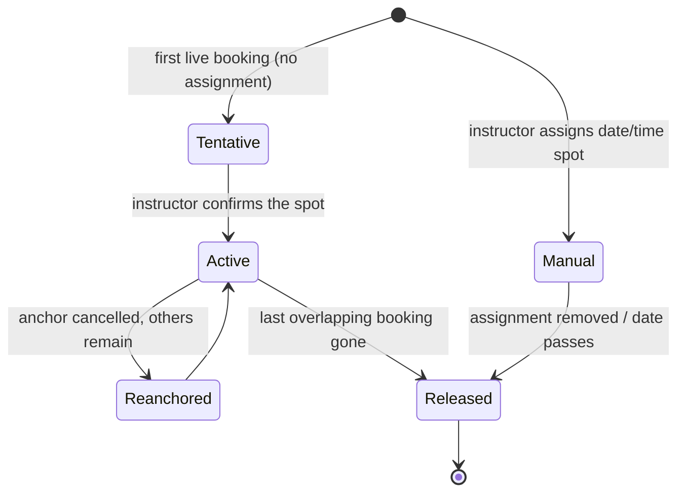

# Spot-Pinned Booking - Revised Analysis and Recommended Flow (V2)

> **Supersedes:** the first `SPOT_BASED_BOOKING_PROPOSAL.md`.
>
> **What changed in this revision:** the business rule is now explicit - **capacity belongs to the instructor, not the spot**. There is no maximum number of students or instructors per surf spot. Each instructor has a limited number of seats (L1 = 2, L2 = 1, L3 = 5, configurable), and an instructor's overlapping time window is pinned to **one** surf spot.
>
> **Status:** analysis and proposal. No code has been changed.

---

## Table of contents

1. [Corrected business rules](#1-corrected-business-rules)
2. [The real bug in the current flow](#2-the-real-bug-in-the-current-flow)
3. [The suggestion you pasted: what it gets right](#3-the-suggestion-you-pasted-what-it-gets-right)
4. [The suggestion you pasted: gaps and corrections](#4-the-suggestion-you-pasted-gaps-and-corrections)
5. [Side-by-side comparison](#5-side-by-side-comparison)
6. [Recommended flow](#6-recommended-flow)
7. [Capacity and spot-pin rules](#7-capacity-and-spot-pin-rules)
8. [Data model](#8-data-model)
9. [Tide engine and discovery API](#9-tide-engine-and-discovery-api)
10. [Skill-level matching preservation](#10-skill-level-matching-preservation)
11. [Pin lifecycle and edge cases](#11-pin-lifecycle-and-edge-cases)
12. [Phased implementation](#12-phased-implementation)
13. [Open questions for SISA](#13-open-questions-for-sisa)
14. [Decision summary](#14-decision-summary)
15. [Sources](#15-sources)

---

## 1. Corrected business rules

| Rule | Decision |
|---|---|
| **Seat capacity** | Per **instructor**, by level: L1 = 2, L2 = 1, L3 = 5. Configurable via `SIASURF_LEVEL{1,2,3}_CAPACITY`. |
| **Spot capacity** | **None.** No maximum students and no maximum instructors per surf spot. |
| **Spot closures** | SISA may still close a spot for safety, events or access (`is_bookable = false`). That is a closure, not a capacity limit. |
| **One instructor, one spot** | An instructor's overlapping time window must be pinned to exactly one `surf_spot_id`. |
| **Skill -> instructor visibility** | Beginner sees L1, L2 and L3; intermediate sees L2 and L3; advanced/expert sees L3 only. Unchanged. |
| **Skill -> spot difficulty** | Beginner -> beginner breaks; intermediate -> beginner + intermediate; advanced -> all. Unchanged. |
| **Group rule** | The most restrictive participant governs the party. Unchanged. |
| **Tide** | A spot is bookable only inside its tide-safe window. |
| **Who chooses the spot** | The **instructor** assigns/pins it. The student's spot choice is a request until the instructor confirms it, unless the instructor has pre-assigned the spot. |

This is a simpler model than the first proposal: the spot is a **location with tide rules**, not an inventory unit. The instructor is the inventory unit.

---

## 2. The real bug in the current flow

`AvailabilityService::remainingCapacity()` queries live bookings by `instructor_id`, `date` and time overlap, then sums `student_count`. It never looks at `surf_spot_id`.

Consequences:

- A Level 3 instructor with 5 seats can accept Student A at 06:00-08:00 for Cloud 9 and Student B at 06:00-08:00 for Jacking Horse. Used seats = 2 of 5, so both pass.
- The instructor is expected at two breaks at the same time.
- Raising `SIASURF_LEVEL2_CAPACITY` would reproduce the same bug for Level 2.
- The current `lockForUpdate` protects the instructor row from capacity races, but not from spot races.

The fix is not "add a spot capacity". It is: **make the spot an invariant of the instructor's time window.**

Two bookings may share the instructor and time **only if they share the same spot** and the instructor's seat capacity is respected.

---

## 3. The suggestion you pasted: what it gets right

The suggestion is largely correct and is a strong improvement over the current flow. It correctly identifies:

1. **The physical conflict**: capacity is instructor-scoped; the location is never locked.
2. **Tide and spot as the first availability layer**, with instructors attaching to spots and times.
3. **Option A (pre-assigned spot)** and **Option B (first-booking lock)** as the two ways to bind a spot to a time block.
4. **The weekly pattern vs daily tide drift problem**: a spot hardcoded into a recurring weekday rule may be wrong next week because tides shift roughly 50 minutes per day.
5. **Two-tier spot assignment**: default/preferred spots plus date-specific assignments.
6. **The pinning rule**: once the first live booking exists at 06:00-08:00 for spot X, later students can only join spot X for that instructor/time, up to the instructor's remaining capacity.
7. **Skill matching is preserved**: `SkillLevel::mostRestrictive()`, `allowedSurfSpotDifficulties()` and `instructorLevels()` still apply.
8. **The downstream lifecycle is unchanged**: waivers, parental consent, GCash/cash, receipt verification, 2-hour acceptance, 15-minute hold, SISA.
9. **Walk-in QR can prefill the spot** if the instructor is assigned/pinned at that time.
10. **The database changes are in the right places**: spot tide fields, spot binding on availability, capacity-aware booking checks, spot-first discovery endpoints.

---

## 4. The suggestion you pasted: gaps and corrections

The suggestion is directionally right. These points need correction before it becomes the final design.

### 4.1 It still mixes in a spot-capacity mental model

The suggestion says there is no maximum seat per spot, but phrases such as "instructor is stationed at that spot" and "remaining capacity for the valid tide hours" read as if the spot has its own inventory. The final model must be explicit:

- `capacity` is always `instructor + level`.
- `surf_spots` has **no** `max_students` and **no** `max_concurrent_groups`.
- A spot can host any number of instructors and students at the same time; SISA can close it (`is_bookable = false`) but cannot set a seat cap.

### 4.2 Option A vs Option B: the instructor must be primary

The suggestion presents both options without choosing. Your requirement is that the **instructor chooses the spot**, so:

- **Primary:** the instructor pre-assigns a spot to a date/time block (or has a preferred spot default).
- **Fallback:** if the instructor has no assignment, the first live booking pins the student's tide-valid choice, and the instructor must confirm or change it before accepting.

Option B alone makes the **first student** the spot chooser, which contradicts the requirement. It should never override an instructor preference.

### 4.3 A static weekly spot is not enough

Adding `surf_spot_id` to the recurring `availabilities` row is useful as a **default**, but it cannot be the only binding:

- Tides shift roughly 50 minutes per day.
- A spot that is safe at 06:00 on Monday may be unsafe at 06:00 on Friday.
- A hardcoded weekly spot ages badly and can produce unsafe bookings.

Use three layers:

1. **Weekly working hours** (existing): when the instructor works.
2. **Preferred spots** (new): a ranked list of spots the instructor likes to teach, used as the default suggestion.
3. **Date-specific assignment** (new): the instructor pins a spot to a date/time block; it overrides the preference and is tide-validated.

`availabilities.surf_spot_id` can exist as a **default preference** for that weekly block, but it must be re-validated against the tide for each date and must not block a date-specific override.

### 4.4 The pin lifecycle is missing

The suggestion does not say what happens when the anchor booking goes away. Required behaviour:

- **Pending -> declined / expired:** release the pin if no other live booking overlaps; otherwise re-anchor to the earliest live booking.
- **Awaiting payment -> payment timeout:** same.
- **Confirmed -> cancelled:** same.
- **Anchor cancelled while other bookings remain:** the pin stays on the same spot and the anchor moves to the next live booking.
- **Manual assignment:** the pin survives booking cancellations until the instructor removes the assignment or the date passes.

Without this, a single decline can leave the slot pinned forever, or free it while other students are still booked.

### 4.5 The first-booking race is not addressed

Two students can submit at the same instant, each with a different spot. The capacity `lockForUpdate` protects seats, not the spot. The booking transaction must:

1. Lock the instructor row (`SELECT ... FOR UPDATE`).
2. Re-read live overlapping bookings.
3. Resolve the pin.
4. Reject if the requested spot differs from the pin.
5. Create the booking and the pin in the same transaction.

Only then is the invariant guaranteed.

### 4.6 Spot changes after payment need a formal flow

If the instructor decides the tide is wrong after the student paid, the spot cannot silently change. Required:

- Instructor proposes a new spot (and optionally a new time) with a reason.
- Student accepts or declines.
- If declined, the normal cancellation/refund policy applies.
- SISA can force a safety cancellation at any time.

### 4.7 Tide rules need numbers, not labels

`best_tide` values ("Mid to high", "Mid", "Low to mid") are human labels. The engine needs:

- `tide_min_m` and `tide_max_m` per spot.
- optional `tide_direction` (`rising`, `falling`, `any`).
- operating hours / daylight.
- optional swell and wind ceilings.

SISA must calibrate the bands against the Stormglass datum. A spot with no calibrated band should be "conditions unknown - instructor confirmation required", not silently safe.

### 4.8 "No maximum instructors per spot" still needs a safety valve

No seat cap is correct. But SISA must be able to close a break for a competition, a hazard, a rescue or a local ordinance. Keep `is_bookable` and `closed_reason`; that is a closure, not a capacity.

### 4.9 The skill filter must apply to the instructor list, not only the spot

The suggestion applies `allowedSurfSpotDifficulties()` to the spot and `instructorLevels()` to the instructor; that is correct. Make it explicit in the discovery API:

- Beginner: spots = beginner; instructors = L1/L2/L3.
- Intermediate: spots = beginner/intermediate; instructors = L2/L3.
- Advanced/expert: spots = all; instructors = L3.

### 4.10 "Instructor is stationed at that spot" is the wrong wording

Instructors are not stationed. They are **assigned** (manual pin) or **pinned by the first booking** (dynamic pin). Use that language in the UI so students understand that the spot can still be confirmed or changed by the instructor.

### 4.11 Walk-in prefill is conditional

The QR page can prefill the spot only if the instructor has a manual assignment or a live pin at that time. Otherwise show "the instructor will confirm the spot" and let the walk-in request the time.

### 4.12 The "beginner blocked at an intermediate spot" rule is correct, but note the trade-off

If a Level 3 instructor is pinned to an intermediate spot, a beginner cannot join that slot because the spot difficulty exceeds their level. The instructor can avoid this by choosing a beginner spot on beginner-heavy days. This is the correct safety behaviour, but the instructor UI should show the allowed student levels for the pinned spot.

### 4.13 The suggestion's capacity check is right, but its formula needs the spot dimension

The suggestion says:

```
sum(student_count) + new_students <= capacity
```

That is correct for seats. Add the invariant:

```
distinct(surf_spot_id) of all live overlapping bookings == 1
AND requested surf_spot_id == that spot
```

Capacity does not include the spot. The spot is a separate, boolean-style constraint.

### 4.14 The suggestion's "first booking locks the spot" needs a pin record

Relying only on "look at the first booking" is fragile:

- The anchor can be cancelled while other bookings remain.
- The instructor may pre-assign a spot before any booking exists.
- The UI needs to show the pinned spot before a booking is created.

Use an explicit `instructor_slot_pins` row (or derive it from the earliest live booking plus manual assignments). The pin record makes the state visible, auditable and testable.

---

## 5. Side-by-side comparison

| Dimension | Current flow | The suggestion you pasted | Recommended V2 |
|---|---|---|---|
| **Capacity unit** | Instructor + time (`student_count`) | Instructor + time (correct) | Instructor + time (same) |
| **Spot capacity** | None | None (but language is ambiguous) | **Explicitly none**; only `is_bookable` closures |
| **Who chooses the spot** | Student | System tide filter + instructor assignment, or first booking | **Instructor assigns (primary); first booking pins as fallback; instructor confirms** |
| **Instructor-spot binding** | None | Option A (pre-assigned) or Option B (first booking) | `instructor_slot_pins`: manual assignment > live booking > preferred default |
| **Tide** | Passive warning | Proactive gate | Proactive gate with numeric per-spot bands and a safe-window fit |
| **Skill matching** | Instructor levels + spot difficulty | Preserved | Preserved exactly (see section 10) |
| **Same instructor, two spots, same time** | Allowed | Prevented by the pin | Prevented by the pin + transaction check |
| **Race on the first booking** | Capacity lock only | Not addressed | Instructor row lock + pin re-check in the same transaction |
| **Pin release when the anchor is cancelled** | Not applicable | Not addressed | Explicit lifecycle: release or re-anchor |
| **Weekly pattern vs daily tide** | No spot on the pattern | Identified; two-tier solution | Weekly hours + preferred spots + date-specific assignments |
| **Spot change after payment** | Not possible (spot is fixed) | Not addressed | Formal change request with student consent |
| **Walk-in QR** | Student still picks a spot | Prefill from the current assignment | Prefill when assigned/pinned; otherwise confirm |
| **Downstream lifecycle** | Waivers, GCash/cash, timers, SISA | Unchanged | Unchanged |
| **Schema changes** | - | Spot tide fields + `availabilities.surf_spot_id` | Spot tide fields + preferred spots + date assignments + slot pins + booking audit fields |
| **Fit for SiaSurf** | Weak (physical conflict) | Strong, with corrections | **Best fit for the stated rules** |

### 5.1 The verdict on the suggestion

The suggestion is **substantially correct** and better than the current flow. Its core insight - bind the instructor's time window to one spot and use the tide as a gate - is the right fix.

The V2 recommendation keeps that core and corrects four things:

1. **No spot capacity anywhere** (your rule).
2. **Instructor assignment is primary**, first-booking pin is the fallback (your rule).
3. **Do not hardcode the spot into the weekly recurring row** as the only binding (tide drift).
4. **Model the pin explicitly** with a lifecycle and a transactional check (cancellation, race, spot changes).

### 5.2 Why not the session-based model from V1?

The first proposal used `lesson_sessions` with seat capacity and a spot per session. That is a valid industry pattern, but it is heavier than necessary for your rules:

- Your capacity is instructor-scoped, so a session's seats duplicate the instructor's seats.
- Sessions require instructors to publish a catalogue, which is extra work.
- The pin model delivers the same physical guarantee with less schema and less instructor effort.
- Sessions can still be added later as a **UI convenience** (an instructor can create a "session" that is just a pre-assigned spot + time). They should not be the capacity unit.

### 5.3 Why not pure spot-first without a pin?

If students pick spots independently and the instructor's calendar is time-only, the original bug returns. A spot-first UI without a pin is only a discovery layer; the invariant must live in the booking service.

---

## 6. Recommended flow

### 6.1 Student journey

```
Step 1 - When and who
  date, time window, party size, skill level (from profile), board ownership

Step 2 - Where (tide + skill filtered)
  system lists surf spots that are:
    active, not closed,
    difficulty allowed for the party,
    tide-safe for the requested window,
    staffed by at least one instructor with enough seats
  unsafe or unstaffed spots are shown disabled with a reason

Step 3 - Choose a spot
  spot detail: safe tide window, conditions, difficulty, area, access,
  allowed student levels, and the available instructors

Step 4 - Choose an instructor and time
  instructors are filtered by:
    skill-level visibility (section 10),
    tide-safe window,
    remaining instructor capacity,
    the instructor's assignment/pin (the spot must match)
  the time options are the intersection of the instructor's hours and the tide window

Step 5 - Details + safety
  participants, board rule, emergency/medical info
  server re-validates skill, spot difficulty, tide, capacity and pin

Step 6 - Waivers
  liability per participant; parental consent for minors

Step 7 - Payment
  GCash (checkout or receipt) or cash; 15-minute seat hold

Step 8 - Confirmation
  booking shows the spot and whether it is:
    "Confirmed by your instructor" (pre-assigned), or
    "Requested - your instructor will confirm the spot"
```

### 6.2 Instructor journey

```
1. Weekly working hours (existing).
2. Preferred spots (new): rank the breaks you like to teach. This is the default.
3. Optional date assignment (new):
   "Oct 30, 06:00-10:00 at Jacking Horse" - tide-validated when saved.
4. Requests:
   - If the slot is assigned, students can only book that spot.
   - If the slot is not assigned, the first live booking pins its spot;
     you see the pin and confirm or change it before accepting.
5. Roster shows the pinned spot and the student levels allowed at that spot.
6. Day-of: re-check tide/swell/wind. If unsafe, propose a spot/time change.
7. Start, attendance, complete, reviews as today.
```

### 6.3 SISA / admin journey

```
1. Maintain spot rules:
   difficulty, safe zone, tide_min_m/tide_max_m, tide direction,
   operating hours, access, hazards, is_bookable, closed_reason.
2. Close a spot for safety/events (not a capacity limit).
3. Oversee pins and sessions; resolve spot disputes.
4. Suspend instructors and cancel bookings as today.
```

### 6.4 Walk-in / QR journey

```
1. Student scans the instructor's QR.
2. If the instructor has a manual assignment or a live pin for "now":
   the spot is prefilled and the student books that spot.
3. Otherwise:
   the page says "your instructor will confirm the best break"
   and the student requests a time; the instructor pins a tide-valid spot.
```

### 6.5 Instructor-first fallback

Keep the existing `/instructors` directory and `/bookings/create/{instructor}` form as a fallback for:

- students who already know the instructor,
- instructors who do not publish preferences/assignments,
- custom requests outside the tide-filtered catalogue.

The form must still enforce the pin: if the instructor already has a live booking at that time, the spot dropdown is locked to the pinned spot.

### 6.6 What the student sees when the pin changes

- If the instructor changes the spot before acceptance: the request is updated and the student is notified; they can cancel free of charge.
- If the instructor wants a different spot after confirmation: a formal change request; the student accepts or declines.
- If SISA closes the spot: the booking is cancelled for safety with a full refund/rebook option.

No silent spot changes.

---

## 7. Capacity and spot-pin rules

### 7.1 Capacity is instructor-scoped

```
capacity(instructor) = InstructorLevel::slotCapacity()
                      (config: L1=2, L2=1, L3=5)

used(instructor, date, start, end) =
  sum(student_count) of live bookings
  where instructor_id = instructor
    and date = date
    and status in (pending, awaiting_payment, confirmed, in_progress)
    and existing.start_time < end
    and existing.end_time > start

remaining = max(0, capacity - used)
```

No spot term appears in this formula. The spot is a separate invariant.

### 7.2 The pin invariant

For one instructor and an overlapping time window:

```
all live bookings must have the same surf_spot_id
```

This is enforced in the booking transaction. A new booking is rejected if it requests a different spot from the pin.

### 7.3 Pin resolution order

When resolving the spot for an instructor + date + time block:

1. **Manual assignment** for that date/time (`availability_spot_assignments`): highest priority. The instructor has explicitly chosen the spot.
2. **Live booking pin** (`instructor_slot_pins` with a live anchor, or derived from overlapping live bookings): the spot is fixed until the last overlapping booking is gone.
3. **Preferred spot** for that weekday/period (`instructor_preferred_spots`): used as the default suggestion, not a hard lock.
4. **Student request** (no assignment, no live booking): the first tide-valid request creates a **tentative** pin; the instructor must confirm or change it.

If a manual assignment exists, students cannot request a different spot for that time.

### 7.4 Booking transaction

```
BEGIN
  lock the instructor row (SELECT ... FOR UPDATE)

  -- capacity
  used = sum(student_count) of live overlapping bookings
  if used + requested_students > capacity -> reject

  -- spot pin
  pin = resolve_pin(instructor, date, start, end)
  if pin exists and pin.surf_spot_id != requested_spot -> reject
  if no pin -> pin = requested_spot (tentative, anchored to this booking)

  -- tide + safety
  assert tide_safe(requested_spot, date, start, end)
  assert safety_rules(party, instructor, requested_spot)

  create booking
  create/update instructor_slot_pin
  create participants
  hold seat for 15 minutes
COMMIT
```

The existing code already locks the instructor row and re-checks capacity; the pin check belongs in the same block.

### 7.5 Pin release and re-anchor

| Event | Pin behaviour |
|---|---|
| Anchor booking declined | If other live bookings overlap, re-anchor to the earliest live booking (same spot). Otherwise release the dynamic pin. |
| Anchor booking expires | Same as declined. |
| Anchor booking payment timeout | Same as declined. |
| Anchor booking cancelled | Same as declined. |
| Non-anchor booking cancelled | Pin stays; capacity frees. |
| Manual assignment exists | Pin stays until the assignment is removed or the date passes, even if all bookings are cancelled. |
| Instructor changes the assignment | Only if no live bookings exist, or through a formal spot-change flow with student consent. |

### 7.6 Examples

**Example 1 - Level 3, 5 seats, no assignment**

- Student A requests 06:00-08:00 at Jacking Horse (2 students). Transaction pins the slot to Jacking Horse; used = 2.
- Student B requests 06:00-08:00 at Cloud 9. Rejected: "This instructor is teaching at Jacking Horse at that time."
- Student B requests 06:00-08:00 at Jacking Horse (2 students). Accepted; used = 4.
- Student C requests 06:00-08:00 at Jacking Horse (2 students). Rejected: only 1 seat left.
- Student A cancels. Pin stays (B and C remain); used = 3.
- B and C also cancel. Pin releases.

**Example 2 - Level 2, 1 seat**

- Student A books 06:00-08:00 at Cloud 9. Used = 1 = capacity.
- Student B cannot book any spot at that time: capacity is full. The spot dimension does not add seats.

**Example 3 - Level 1, 2 seats, exclusive**

- Student A requests 06:00-08:00 at Jacking Horse (2 students). The slot is exclusive; no second booking at any spot.
- If A cancels, the pin releases.

**Example 4 - Manual assignment**

- Instructor assigns 06:00-10:00 at Jacking Horse for Oct 30.
- The student spot-first page shows only Jacking Horse for that instructor/time.
- A request for Cloud 9 is rejected even if the instructor has capacity.

### 7.7 MySQL implementation notes

- The overlap predicate is `existing.start_time < new.end_time AND existing.end_time > new.start_time`.
- MySQL 8 has no range exclusion constraints. The instructor row lock plus the pin re-check inside the transaction is the practical guarantee.
- If a database-level guarantee is required, add `instructor_slot_allocations` with a unique key on `(instructor_id, date, slot_start)` for 30/60-minute buckets. This also prevents two overlapping rows even if a future code path forgets the service check.
- Keep `surf_spot_id` indexed on bookings and pins; the pin query filters by instructor, date and time.

### 7.8 What availability returns

For a spot-first search, an instructor is available for a spot/time only if:

```
instructor is bookable
AND instructor level is visible to the student's skill
AND remaining_capacity >= party_size
AND (pin is null OR pin.surf_spot_id == spot.id)
AND spot is active/bookable
AND tide is safe for the range
```

The current `GET /api/availability/{instructor}` remains useful for the instructor-first fallback; add a spot-first endpoint that returns spots with their available instructors.

---

## 8. Data model

### 8.1 `surf_spots` - location + tide rules, no capacity

| Column | Type | Purpose |
|---|---|---|
| `tide_min_m` | decimal(4,2) nullable | Lower safe tide height |
| `tide_max_m` | decimal(4,2) nullable | Upper safe tide height |
| `tide_direction` | string nullable (`any`, `rising`, `falling`) | Push/ebb preference |
| `operating_start` / `operating_end` | time nullable | Daylight/access limits |
| `is_bookable` | boolean default true | SISA closure flag |
| `closed_reason` | string nullable | Why the spot is closed |
| `max_swell_m` / `max_wind_kmh` | decimal nullable | Optional conditions ceilings |
| `season_months` | json nullable | Optional month allow-list |

**Not added:** `max_students`, `max_concurrent_groups`, or any other spot seat cap. A spot is not inventory.

### 8.2 `instructor_preferred_spots` - default choices

```
id
user_id (instructor, FK users)
surf_spot_id (FK surf_spots)
priority (unsignedTinyInteger, default 1)
is_default (boolean, default false)
timestamps
unique(user_id, surf_spot_id)
index(user_id, priority)
```

Used to suggest a spot when the instructor has no date-specific assignment. It is a preference, not a hard pin.

### 8.3 `availability_spot_assignments` - date-specific pins

```
id
instructor_id (FK users)
date (date)
start_time (time)
end_time (time)
surf_spot_id (FK surf_spots)
source (manual|preferred|first_booking)
anchor_booking_id (FK bookings, nullable)
notes (text, nullable)
created_by (FK users, nullable)
timestamps
index(instructor_id, date, start_time)
```

This is where the instructor explicitly chooses "Oct 30, 06:00-10:00 at Jacking Horse". It overrides preferences and is tide-validated when saved.

An alternative is a single `instructor_slot_pins` table for both manual and dynamic pins; the important part is that the pin is persisted and auditable.

### 8.4 `availabilities.surf_spot_id` - optional default

You can add a nullable `surf_spot_id` to the recurring `availabilities` row as a **default preference** for that weekday/period. It must not be the only binding:

- re-validate it against the tide for each date,
- allow a date-specific assignment to override it,
- fall back to "instructor confirms" when the tide does not suit it.

If you prefer one source of truth, skip this column and use `instructor_preferred_spots` instead. The V2 recommendation is the separate preference table.

### 8.5 `instructor_slot_pins` - the live invariant

```
id
instructor_id (FK users)
date (date)
start_time (time)
end_time (time)
surf_spot_id (FK surf_spots)
source (manual|first_booking)
anchor_booking_id (FK bookings, nullable)
status (active|released)
timestamps
index(instructor_id, date, status)
```

- Created when the first live booking is made without a manual assignment, or when the instructor assigns a spot.
- Updated/re-anchored when the anchor is cancelled but other bookings remain.
- Released when the last overlapping booking is gone (dynamic pins only).
- Manual pins survive until removed.

### 8.6 `bookings` additions

| Column | Purpose |
|---|---|
| `spot_confirmed_at` / `spot_confirmed_by` | When and by whom the instructor confirmed the spot |
| `spot_source` (student|instructor|first_booking) | Why this spot was chosen |
| `tide_snapshot` json | Tide forecast used at booking time |
| `spot_pin_id` nullable FK | The pin that governed this booking |

`surf_spot_id` stays on the booking as today.

### 8.7 What is NOT added

- No `lesson_sessions` in the MVP. Capacity is instructor-scoped; sessions would duplicate it. They can be added later as a UI convenience for pre-assigned spots.
- No `max_students`/`max_groups` per spot.
- No spot qualification table in the MVP. If SISA later wants to restrict which instructors may teach which breaks, add `instructor_surf_spots` as an optional layer; the current difficulty/skill rules already provide a safety baseline.

---

## 9. Tide engine and discovery API

### 9.1 Tide rules per spot

Replace the free-text-only `best_tide` with numeric bands:

| `best_tide` label | Suggested `tide_min_m` / `tide_max_m` |
|---|---|
| Low to mid | 0.0 / 1.1 |
| Mid | 0.7 / 1.5 |
| Mid to high | 0.9 / 2.2 |
| Mid to high only | 0.9 / 2.2, direction `rising` if confirmed |

These are starting values; SISA calibrates per break against the Stormglass datum.

### 9.2 Safe windows

```
for each consecutive pair of tide extremes (high/low):
  interpolate the height at minute t
  keep minutes where:
    tide_min_m <= height <= tide_max_m
    (optional) tide_direction matches rising/falling
    operating_start <= t <= operating_end
merge adjacent minutes into windows
subtract a safety buffer (e.g., 30 min) at both ends
```

A lesson is valid only if the whole `[start, end)` fits inside one safe window.

### 9.3 Conditions and unknown data

- Optional ceilings: `max_swell_m`, `max_wind_kmh`, `season_months`.
- If tide/weather data is missing: spot state = "unknown - instructor confirmation required". Do not silently allow.
- Store the snapshot on the booking so the decision is auditable.
- Re-check on the day; if the spot is no longer safe, the instructor proposes a change or SISA cancels.

### 9.4 Discovery endpoints

| Method | URI | Purpose |
|---|---|---|
| GET | `/api/spots/available?date=&start=&end=&students=&skill=` | Tide-safe, skill-allowed spots with at least one available instructor |
| GET | `/api/spots/{spot}/instructors?date=&start=&end=&students=&skill=` | Instructors available for that spot/time |
| GET | `/api/spots/{spot}/tide-windows?date=` | Safe windows for the spot |
| GET | `/api/availability/{instructor}` | Existing instructor-first fallback |

`/api/spots/available` response (shape):

```json
[
  {
    "id": 12,
    "name": "Jacking Horse (Inner)",
    "area": "General Luna",
    "difficulty": "beginner",
    "safe_zone": true,
    "tide_window": { "start": "06:00", "end": "09:30", "state": "mid-rising" },
    "conditions": { "swell_m": 1.1, "wind_kmh": 9, "status": "good" },
    "instructors": [
      { "id": 4, "name": "Coach A", "level": 3, "seats_left": 3, "pinned": false }
    ]
  }
]
```

`/api/spots/{spot}/instructors` must return only instructors who:

1. are bookable (active, verified, not suspended),
2. pass `SkillLevel::instructorLevels()` for the student,
3. have `remaining_capacity >= students`,
4. have no pin for a different spot at that time,
5. are tide-safe at the spot/time.

### 9.5 What the UI does with the response

- Spot cards show the safe window and the available instructor count.
- A disabled spot shows "tide too low/high", "not safe for your level", "no instructor available", or "closed".
- The instructor list groups by level and shows remaining seats.
- The student picks an instructor and an exact start/end inside the safe window.

---

## 10. Skill-level matching preservation

The current rules stay exactly as they are. They are applied at two layers.

### 10.1 Spot difficulty vs student level

`SkillLevel::allowedSurfSpotDifficulties()`:

| Student / party level | Allowed spot difficulty |
|---|---|
| Beginner | beginner |
| Intermediate | beginner, intermediate |
| Advanced / expert | beginner, intermediate, advanced |

### 10.2 Instructor level vs student level

`SkillLevel::instructorLevels()`:

| Student level | Instructors visible |
|---|---|
| Beginner | Level 1, 2 and 3 |
| Intermediate | Level 2 and 3 |
| Advanced / expert | Level 3 only |

### 10.3 Combined matrix

| Student level | Spots they can see | Instructors they can see there |
|---|---|---|
| Beginner | beginner | L1, L2, L3 |
| Intermediate | beginner, intermediate | L2, L3 |
| Advanced / expert | all | L3 |

This means:

- A beginner at a beginner spot can book L1, L2 or L3.
- An intermediate at a beginner or intermediate spot sees only L2/L3 (never L1).
- An advanced student at any spot sees only L3.
- A Level 3 instructor pinned to an intermediate spot cannot take beginners for that slot; the spot difficulty filter excludes them.
- A group uses `SkillLevel::mostRestrictive()`, so one beginner forces a beginner spot and the group's instructor list follows the beginner row.

### 10.4 Safety rules remain the final gate

`SafetyService` still enforces:

- L1: max 2 students, beginners only.
- L2: 1-on-1.
- L3: max 5.
- Age 5-12 requires a Level 3 instructor.
- Beginner safe zones.
- Certification match.

The spot-first UI must never bypass these; it only narrows the choices.

---

## 11. Pin lifecycle and edge cases

| Scenario | Expected behaviour |
|---|---|
| First request, no assignment | The requested spot becomes a tentative pin; the instructor sees it and confirms or changes before accepting. |
| Second request, same spot, seats left | Accepted; seat capacity decrements. |
| Second request, different spot | Rejected with "This instructor is teaching at {spot} at that time." |
| Second request, different spot, no seats | Rejected on capacity first; the spot rule is not even reached. |
| Anchor declined | If others overlap, re-anchor to the earliest live booking; otherwise release the dynamic pin. |
| Anchor expires / payment timeout | Same as declined. |
| Non-anchor booking cancelled | Pin stays; seats free. |
| Manual assignment | Pin stays until the assignment is removed or the date passes, even if all bookings are cancelled. |
| Instructor changes an assignment before any booking | Allowed, provided the new spot is tide-safe. |
| Instructor wants a different spot after bookings exist | Formal change request; students accept or decline; if declined, cancellation/refund policy applies. |
| SISA closes the spot | All sessions/bookings at that spot are cancelled for safety; students are notified and rebook/refund. |
| Walk-in QR | Prefill the assignment/pin if one exists; otherwise create a request and let the instructor pin. |
| Two first requests at the same instant, different spots | Instructor row lock serialises them; the first commits, the second is rejected. |
| Student changes party size | Re-validate capacity; the spot is already pinned. |
| Instructor suspended | Future bookings cancelled; pins released. |
| Instructor goes on vacation (`inactive`) | Hidden from discovery; existing bookings keep their pin until cancelled/completed. |

### 11.1 Pin state machine



---

## 12. Phased implementation

### Phase 0 - Pin invariant + instructor confirmation (small, 1-2 weeks)

Goal: fix the physical conflict without changing the student flow.

- Add the pin check to `BookingController::storeDetails` inside the existing transaction: if any live overlapping booking exists for the instructor, the requested `surf_spot_id` must match.
- Add `spot_confirmed_at`, `spot_confirmed_by` and `spot_source` to bookings.
- Require the instructor to confirm the spot before `confirmed` (or when accepting).
- Add a minimal `instructor_slot_pins` table or derive the pin from live bookings.
- Release/re-anchor the pin on decline/expire/cancel.
- Show "spot to be confirmed by your instructor" on the student booking.
- Update `BOOKING_FLOWS.md`.

This phase alone makes the current instructor-first flow correct.

### Phase 1 - Tide rules + spot-first discovery (medium, 2-3 weeks)

- Add `tide_min_m`, `tide_max_m`, `tide_direction`, operating hours, `is_bookable`, `closed_reason` to `surf_spots`.
- Build `SpotTideWindowService` from the cached Stormglass extremes.
- Add `GET /api/spots/available` and `/api/spots/{spot}/instructors` with tide + skill + capacity + pin filters.
- Build the spot-first page: date/time -> spot cards -> instructor list.
- Server validates the tide window on booking.
- Keep the existing instructor-first form as a fallback.

### Phase 2 - Preferred spots + date assignments + walk-in (medium, 2-3 weeks)

- Add `instructor_preferred_spots` and `availability_spot_assignments`.
- Instructor UI: preferred spots, date assignment, tide-safe validation.
- Walk-in QR prefills the assignment/pin when available.
- Lock the spot dropdown on the booking form when a pin exists.

### Phase 3 - Pin lifecycle, changes and SISA oversight (medium, 2-3 weeks)

- Formal spot-change flow (instructor proposes, student accepts/declines).
- Day-of re-check and safety cancellations.
- SISA spot closures and pin/session oversight.
- If required later: `instructor_surf_spots` qualifications and optional published sessions.

### What is deliberately not built

- No spot seat capacity.
- No session capacity model.
- No spot qualification in the MVP (optional later).
- No automatic spot switching without student consent.

---

## 13. Open questions for SISA

1. **Tide calibration:** what are the safe `tide_min_m` / `tide_max_m` values for each of the 32 breaks on the Stormglass datum? Does rising vs falling matter?
2. **Default spot per instructor:** should each instructor have one default spot, or a ranked list per weekday/period?
3. **Spot confirmation:** when the instructor has no assignment, is the first student's spot a request that the instructor must confirm before accepting (recommended), or is it auto-confirmed?
4. **Spot changes:** if the instructor changes the spot after payment, is the student entitled to a free cancellation/refund? What is the notice period?
5. **SISA closures:** who can close a spot, and does a closure cancel all bookings automatically?
6. **Qualifications:** should instructors be restricted to SISA-approved spots, or is the current level/difficulty rule enough for the capstone?
7. **Tide data:** does the Stormglass plan cover the request volume and commercial use?
8. **Walk-in:** if the instructor has no pin at the beach, does the walk-in request wait for the instructor to choose, or does the QR page suggest a tide-valid spot?
9. **Conflict UX:** when a student's chosen spot is already pinned to another spot, should the UI hide the instructor entirely or show "teaching at X at this time"?

---

## 14. Decision summary

| Question | Answer |
|---|---|
| Is the pasted suggestion correct? | **Mostly yes.** Its core - tide + spot pinning + instructor capacity - is the right direction. |
| Should capacity be per spot? | **No.** Capacity is per instructor, by level. No spot seat cap, no spot instructor cap. |
| How do we stop two spots for one instructor? | **Pin the instructor's time window to one `surf_spot_id`** and enforce it inside the booking transaction. |
| Who chooses the spot? | **The instructor**: pre-assigned spot first, first-booking pin as fallback, instructor confirms before acceptance. |
| What about the weekly pattern? | Keep weekly hours; add preferred spots and date-specific assignments. Do not hardcode a single spot into the recurring row as the only binding. |
| What about tide? | Numeric per-spot bands; safe windows; the whole lesson must fit; re-check on the day. |
| What about skill matching? | Keep the current rules exactly: spot difficulty + instructor level visibility + most-restrictive group. |
| What about the downstream flow? | Unchanged: details, waivers, GCash/cash, 2-hour accept, 15-minute hold, SISA. |
| What is the best flow? | **Tide- and skill-filtered spot discovery -> instructor assigned/pinned to that spot -> existing booking pipeline.** |
| What is the minimum safe change? | Phase 0: pin invariant + instructor spot confirmation + audit fields. |

### 14.1 Recommended flow in one sentence

> Students search tide-safe spots that match their skill; each instructor is assigned (or pinned on the first booking) to exactly one spot for an overlapping time window; students book that instructor's remaining seats; the instructor confirms the spot before the lesson and any later change is a formal, notified request.

---

## 15. Sources

Industry and technical:

- Checkfront - features (resource management, capacity limits, timeslot availability, no double bookings, rule system): https://www.checkfront.com/features
- Rezdy - features (availability, inventory, resource management, live availability, overbooking prevention): https://www.rezdy.com/features/
- FareHarbor - product surface (availability, capacity, resources, crew, overbooked/overusing resources): https://www.fareharbor.com/features/
- PostgreSQL 18 - Range Types and exclusion constraints (meeting-room reservation example): https://www.postgresql.org/docs/current/rangetypes.html
- NOAA - What are tides? (high/low tide, tidal range): https://oceanservice.noaa.gov/facts/tides.html
- Nielsen Norman Group - Wizards: definition and design recommendations: https://www.nngroup.com/articles/wizards/

Project sources:

- `BOOKING_FLOWS.md` - current student/instructor/admin flow
- `app/Enums/SkillLevel.php` - `instructorLevels()`, `allowedSurfSpotDifficulties()`, `mostRestrictive()`
- `app/Enums/InstructorLevel.php` - `slotCapacity()`, `holdsSlotWhilePending()`
- `app/Services/AvailabilityService.php` - instructor-scoped capacity and slot locking
- `app/Services/SafetyService.php` - L1/L2/L3, age, safe zone, certification rules
- `app/Services/StormglassService.php` - tide extremes cache
- `app/Models/SurfSpot.php` - spot fields and `best_tide`
- `database/seeders/SurfSpotSeeder.php` - 32 spots, difficulty and tide labels
- `app/Http/Controllers/BookingController.php` - booking transaction and validation order
- `resources/js/Pages/Booking/Create.vue` - current student spot picker

